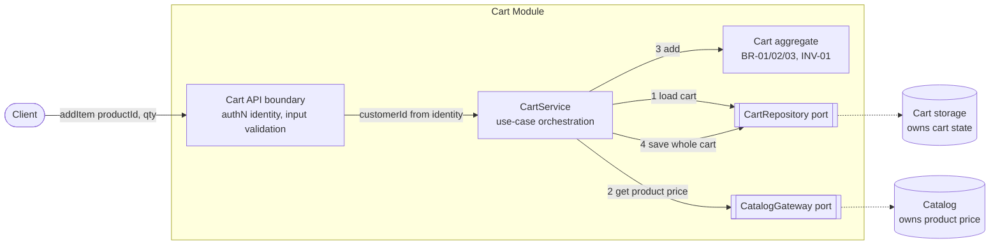
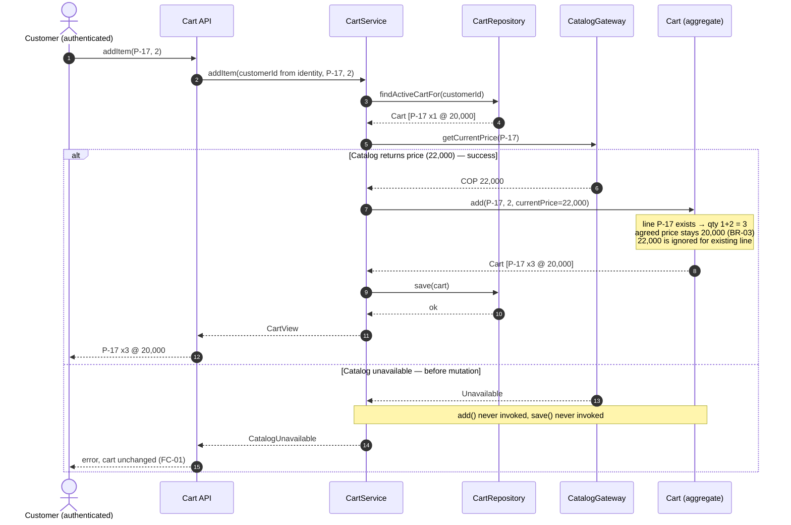
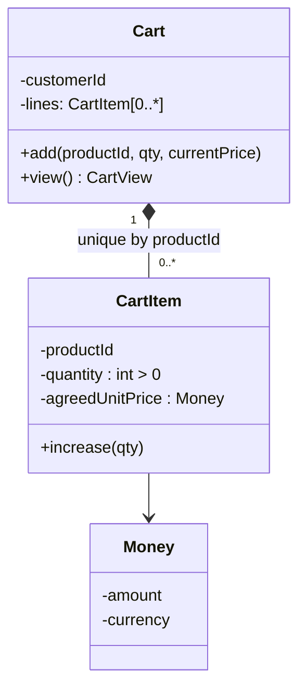

# Technical Design Doc: Add Product to Cart (`addItem`)

| Field | Value |
|---|---|
| Status | **PROPOSAL** — under review. Not approved, not implemented, not tested. |
| Scope | Add Product to Cart capability of the E-Commerce system |
| Audience | Engineering peer review |

**Legend.** Every statement is tagged by kind:

- **APPROVED** — approved requirement (ID from the business owners).
- **D-nn** — proposed design decision (open to challenge).
- **A-nn** — assumption (not verified).
- **Q-nn** — open question (needs stakeholder input; *not* a requirement).

---

## A. Context and Problem

**Business capability (APPROVED FR-01, FR-02).** An authenticated customer adds a product to their active shopping cart and receives the updated cart.

**Scenario.**

| | Product | Quantity | Unit price |
|---|---|---|---|
| Cart before | P-17 | 1 | COP 20,000 (agreed) |
| Request | `addItem(P-17, 2)` | | Catalog now reports COP 22,000 |
| Expected after | P-17 | **3** | **COP 20,000**, exactly one line |

**Engineering problem.** Two sources of price exist for the same product: the price agreed on the existing cart line and the current Catalog price. The design must (1) merge the request into the existing line instead of creating a second one, (2) keep the agreed price when the quantity grows, (3) never trust a client-supplied price or user id, and (4) guarantee that a Catalog outage *before* mutation leaves the cart untouched.

**Business requirements vs. technical decisions.** Everything in section B is a business requirement. Everything labelled D-nn is *our* proposal for satisfying them; reviewers may reject any D-nn without changing the business scope.

## B. Goals

| ID | Goal | Source |
|---|---|---|
| G1 | Add a product to the authenticated customer's active cart | FR-01 |
| G2 | Return the updated cart state on success | FR-02 |
| G3 | Adding an existing product increases its quantity | BR-01 |
| G4 | At most one line per product per cart | BR-02 |
| G5 | Existing line keeps its agreed unit price when quantity increases | BR-03 |
| G6 | Catalog unavailable before mutation → cart unchanged | FC-01 |
| G7 | No persisted item with quantity ≤ 0 | INV-01 |
| G8 | Cart selected from authenticated identity only | SEC-01 |
| G9 | No client-provided price is trusted | SEC-02 |

## C. Non-Goals

- Stock availability checks, their timing, maximum quantity and cart expiration (all unresolved — see Q-01..Q-04). The design neither implements nor forbids them.
- Remove/update-quantity operations, checkout, order creation, payment.
- Deciding what happens when the agreed price and the Catalog price diverge (price-change notification or refresh policy).
- Concurrent-request handling (the scenario assumes none; see A-03, R-03).
- Choice of persistence technology, web framework, or deployment topology.

## D. Design Considerations

**Requirements driving the shape of the solution.**

- BR-02 + BR-03 + INV-01 are all *rules about the set of lines in a cart*. They are best enforced in one place that sees the whole cart, not scattered over callers.
- FC-01 constrains ordering: all external reads (Catalog) must complete **before** any state change.
- SEC-01/02 constrain the interface: no `userId` and no `price` input is accepted as authoritative.

**Quality concerns.** Simplicity, testability of business rules without Catalog or storage, information hiding of the Catalog and storage details, traceability to requirements.

**Constraints.** No microservices, frameworks, database engines or infrastructure are assumed without a requirement.

**Assumptions.**

| ID | Assumption | Risk if false |
|---|---|---|
| A-01 | A trusted authentication layer supplies a verified customer identity to the use case. | SEC-01 cannot be demonstrated. |
| A-02 | Each authenticated customer has at most one *active* cart, resolvable from identity. | Need an explicit cart-selection rule. |
| A-03 | No concurrent mutations of the same cart in the scoped scenario (given by the brief). | Lost updates / duplicate lines under concurrency (R-03). |
| A-04 | Catalog is an existing capability exposing "current price and existence of product X" and can signal *unavailable* distinctly from *not found*. | FC-01 branch is not implementable as specified. |
| A-05 | The storage can persist one cart (with its lines) as a single all-or-nothing write. | "Cart unchanged" after a persistence failure is not guaranteed (gap G-02). |
| A-06 | Money is a single currency (COP) per cart. | Needs currency handling in `Money`. |

## E. Proposed Design

### E.1 Overview (D-01: modular monolith with ports)

One deployable unit with four cooperating modules. Catalog and storage are reached only through narrow interfaces ("ports"), so the cart rules do not depend on how either is implemented. No new network service is introduced by this design.



### E.2 Component responsibilities (information hiding)

| Component | Responsibility | Hides |
|---|---|---|
| **Cart API boundary** | Obtains the verified identity, validates the shape of input (`productId` present, `quantity` is an integer), maps results/errors to responses (FR-02). Does **not** accept `userId` or `price`. | Authentication mechanism, transport. |
| **CartService** | Orchestrates one use case in a fixed order: load cart → read Catalog → mutate → persist → return view. Holds no business rules. | Sequencing, error mapping. |
| **Cart aggregate** | Owns the lines; the only code allowed to change them. Enforces BR-01 (merge), BR-02 (one line per product), BR-03 (keep agreed price), INV-01 (quantity > 0). | Internal line collection. |
| **CatalogGateway (port)** | `getCurrentPrice(productId)` → price, or *NotFound*, or *Unavailable*. | Catalog protocol/location/retries. |
| **CartRepository (port)** | `findActiveCartFor(customerId)` and `save(cart)` as one atomic write of the aggregate. | Storage technology, schema. |

*Cohesion/coupling note:* business rules live in one module with no outward dependencies (the aggregate); the two ports are the only coupling to the outside world, and both point inward-defined interfaces.

### E.3 Data ownership and state management

- **Catalog owns** the current product price. The cart never writes to Catalog.
- **Cart module owns** cart state, including each line's *agreed unit price* (a snapshot copied from Catalog **only when a line is created**, D-02).
- **State change happens in exactly one place and one moment:** the aggregate is mutated in memory only after every external read succeeded (D-03), and persisted with a single `save` (A-05). If anything fails before `save`, nothing was written.

### E.4 Key decisions

| ID | Decision | Why | Alternative considered | Trade-off accepted | Reconsider if… |
|---|---|---|---|---|---|
| D-01 | Modular monolith with two ports | Smallest structure that isolates rules from Catalog/storage; no requirement justifies a network boundary | Microservice (G-4) | Ports add two interfaces to maintain | Cart and Catalog need independent scaling/deployment |
| D-02 | Agreed price = Catalog price captured at line creation; never overwritten on quantity increase | BR-03 | Re-price on every add (G-3) | Cart price can drift from Catalog (see H) | Business decides that price must refresh |
| D-03 | Read Catalog **before** any mutation, every call to `addItem` | FC-01 must hold even when the line already exists, and Catalog also validates the product exists | Call Catalog only when creating a new line (G-2) | One extra Catalog call for existing lines; Catalog outage blocks even quantity increases | FC-01 is clarified to apply only to new lines, or Catalog availability proves a problem |
| D-04 | Merge/dedupe rules inside the Cart aggregate | BR-02, INV-01 enforced where all lines are visible | Rules in service or DB constraint only (G-5) | Aggregate must be loaded whole | Carts become large enough that loading whole is a demonstrated issue |
| D-05 | Whole-cart load → mutate → single save | Simple; supports "unchanged on failure" | Line-level upsert (G-5) | Higher write granularity | Concurrency requirements appear (R-03) |
| D-06 | Identity from authentication context only | SEC-01 | Accept `userId` param (rejected) | Callers cannot act on behalf of others (e.g., admin tooling needs a separate design) | A support/admin use case is approved |

### E.5 Interactions



### E.6 Internal structure (class diagram, only where it justifies D-04)



Why this level of detail: `CartItem` has no public way to set `agreedUnitPrice` after construction, and `Cart` is the only creator of `CartItem`. This is how BR-02, BR-03 and INV-01 become structural rather than conventional.

Behaviour of `Cart.add(productId, qty, currentPrice)`:

1. Reject `qty ≤ 0` (INV-01).
2. If a line for `productId` exists → increase its quantity; **ignore** `currentPrice` (BR-01, BR-03).
3. Otherwise create a line with `agreedUnitPrice = currentPrice` (D-02) (BR-02 holds: no line existed).

### E.7 Failure handling

| Failure | Detected at | State effect | Outcome |
|---|---|---|---|
| Not authenticated | API | none | `Unauthenticated` |
| Invalid quantity (≤ 0, non-integer) | API and Cart (defense in depth) | none | `InvalidQuantity` |
| No active cart | Repository lookup | none | `NoActiveCart` (Q-05: create one?) |
| Catalog unavailable | Gateway, before mutation | none (no mutation, no save) | `CatalogUnavailable` (FC-01) |
| Product not found in Catalog | Gateway, before mutation | none | `ProductNotFound` |
| Persistence failure on save | Repository | **Depends on A-05** | `PersistenceFailure` (gap G-02) |

### E.8 Security considerations (summary; detail in I)

Cart is chosen by the verified identity (SEC-01); price is read server-side from Catalog, and no price field exists in the interface (SEC-02).

## F. Interface Contract: `addItem`

**Signature (logical).** `addItem(productId, quantity) → CartView`, invoked within an authenticated context.

| Aspect | Specification |
|---|---|
| **Inputs** | `productId`: identifier of an existing product. `quantity`: integer. *Implicit input:* verified customer identity from the security context. **Not inputs:** `userId`, `price`. |
| **Output** | `CartView`: list of lines `{productId, quantity, agreedUnitPrice}` (and totals if the product owner wants them — not required by FR-02). |
| **Preconditions** | (P1) Caller is authenticated (SEC-01). (P2) `quantity ≥ 1` and integer. (P3) Customer has an active cart (A-02). (P4) Catalog reachable and knows `productId`; otherwise see failures. |
| **Postconditions (success)** | (Q1) If a line for `productId` existed: its quantity = old + `quantity`; its agreed price is unchanged (BR-01, BR-03). (Q2) Otherwise: one new line with the requested quantity and agreed price = Catalog price at that moment. (Q3) Exactly one line exists for `productId` (BR-02). (Q4) All other lines are unchanged. (Q5) The returned view equals the persisted state (FR-02). |
| **Postconditions (failure)** | The persisted cart is identical to its state before the call (FC-01), subject to gap G-02 for persistence failures. |
| **Invariants** | INV-01: every persisted item has `quantity > 0`. BR-02: unique `productId` per cart. Agreed price of a line never changes through `addItem` once created. |
| **Failure outcomes** | `Unauthenticated`, `InvalidQuantity`, `NoActiveCart`, `ProductNotFound`, `CatalogUnavailable`, `PersistenceFailure`. Business-unapproved outcomes (e.g., `OutOfStock`, `QuantityLimitExceeded`, `CartExpired`) are **deliberately not defined** (Q-01..Q-04). |

## G. Alternatives Considered

| # | Alternative | How it works | Advantages | Disadvantages | Decision |
|---|---|---|---|---|---|
| G-1 | **Chosen:** Aggregate with price snapshot; Catalog read before mutation (D-01..D-05) | See E | Rules in one place; easy to test without Catalog/storage; FC-01 by ordering | Extra Catalog call; whole-cart load/save | **Selected** |
| G-2 | Call Catalog only when a new line must be created | If a line exists, increase quantity without contacting Catalog | Fewer Catalog dependencies; quantity increases survive a Catalog outage | Does not validate product on existing lines; the FC-01 scenario ("Catalog unavailable") would not apply to this case, which the approved scenario does not say; behaviour differs by path | **Not selected now; strongest competing option.** Needs Q-06 answer. Reconsider if stakeholders accept that outage should not block quantity increases |
| G-3 | Re-price the line to the current Catalog price on every add | Replace unit price with 22,000 | Always current price | **Violates BR-03** (would yield 3 × 22,000) | Rejected: contradicts approved requirement |
| G-4 | Extract a separate Cart (or Pricing) microservice | Network call between services | Independent deployability | Adds distributed failure modes and deployment cost with no requirement that needs it | Rejected: unjustified (engineering principle) |
| G-5 | Line-level upsert in storage with a uniqueness constraint (rules in DB, no aggregate) | `INSERT … ON CONFLICT increase` | Smaller writes; natural fit for concurrency | Business rules (BR-03, INV-01) spread to storage; storage technology gets chosen by this decision; harder to unit-test; would still need Catalog ordering for FC-01 | Rejected for now; reconsider if concurrency (R-03) becomes a requirement |
| G-6 | Accept client-provided price and verify it | Compare to Catalog | Saves nothing meaningful | Client price cannot be authoritative (SEC-02) and the agreed price is a server-side fact | Rejected: contradicts SEC-02 |

No performance numbers are claimed for any option.

## H. Trade-offs

| Gains | Accepted consequences |
|---|---|
| **Maintainability:** rules centralized in the aggregate; ports isolate Catalog/storage changes | Two small interfaces to keep stable |
| **Consistency of the cart:** invariants are structural; cart is changed in one save | Whole-aggregate load/save (cost unmeasured) |
| **Failure safety (FC-01):** ordering "read, then mutate" is simple to reason about | Catalog outage blocks even quantity increases for existing lines (D-03) |
| **Low complexity:** one deployable, no new infra | Does not address concurrency or scaling (explicitly out of scope) |
| **Predictable pricing for the customer (BR-03)** | Agreed price may differ from the current Catalog price; later steps (e.g., checkout) must decide how to reconcile (Q-07) |

**Operational risk.** The Catalog dependency becomes a runtime availability coupling for `addItem`. Timeouts/retry policy are not defined here (R-04).

## I. Security and Privacy

| Requirement | How the design respects it | Evidence in design |
|---|---|---|
| SEC-01 | The cart is looked up using the identity supplied by the authentication layer; the interface has no `userId` parameter, so a caller cannot name another customer's cart (D-06). | Interface contract (F), sequence step 2 |
| SEC-02 | No price field exists in `addItem`. The agreed price is taken from Catalog by the server at line creation and never from the request. | F inputs; aggregate (E.6) |

**Security assumptions requiring confirmation.**

- A-01: the authentication layer is trusted and identity cannot be spoofed by the caller.
- A-02: the mapping identity → active cart is one-to-one; otherwise the cart-selection rule must also be identity-based.
- Logs should avoid customer identifiers beyond what operations require (privacy; policy not provided).
- Input validation on `productId` and `quantity` at the boundary (injection and overflow) — standards not provided.
- Error messages must not reveal whether a product or cart belongs to another customer.

## J. Risks and Open Questions

| ID | Open question / risk | Consequence if unresolved | Decision needed from |
|---|---|---|---|
| Q-01 | Must stock availability be checked? | Customers may add unavailable items; or we build unneeded checks | Product owner |
| Q-02 | If checked, **when**: at add, at checkout, or both? | Changes `addItem` contract (new failure `OutOfStock`) and adds a dependency (Inventory) | Product owner + architects |
| Q-03 | Maximum permitted quantity (per line / per cart)? | Unbounded quantities; possible abuse | Product owner |
| Q-04 | Cart expiration policy? | Stale carts and stale agreed prices persist indefinitely | Product owner |
| Q-05 | If no active cart exists, create one or fail? | `NoActiveCart` vs implicit creation | Product owner |
| Q-06 | Does FC-01 imply Catalog is consulted even when the line exists (D-03), or only for new lines (G-2)? | Behaviour during Catalog outage differs | Product owner + engineering |
| Q-07 | How long does an agreed price remain valid, and how is divergence from Catalog surfaced? | Customer surprise at checkout | Product owner |
| R-03 | Concurrent requests on the same cart (out of scope here) | Lost update or duplicate line | Engineering; needs a separate design |
| R-04 | Catalog timeout/retry semantics undefined | Slow failures or retry storms | Engineering + Catalog owners |
| R-05 | Idempotency of retried `addItem` is undefined | A client retry may add the quantity twice | Engineering + product owner |

## K. Design Review Checklist

| Req | Satisfied by | Evidence available | Gap / note |
|---|---|---|---|
| FR-01 | Use case flow E.5 | Sequence diagram | Design only; not run |
| FR-02 | `CartView` in contract F (Q5) | Contract | Shape of the view not specified beyond lines |
| BR-01 | `Cart.add` step 2 | Class behaviour E.6, walkthrough | — |
| BR-02 | Unique-by-product aggregate | E.6 | Holds under A-03 only (R-03) |
| BR-03 | `currentPrice` ignored for existing line | Walkthrough | — |
| FC-01 | Catalog read before `add`/`save` | Sequence `alt` branch | Holds by ordering for Catalog failure; **persistence failure atomicity depends on A-05 (G-02)** |
| INV-01 | Guard in `Cart.add`, structural creation | E.6 | Persistence-level enforcement not designed (G-03) |
| SEC-01 | No `userId` input; identity-based lookup | F, E.5 | Depends on A-01, A-02 |
| SEC-02 | No price input; Catalog-sourced | F | — |

**Contradictions found:** none between the approved requirements and the design. **Tension:** FC-01 is stated for Catalog being unavailable "before mutation", which does not say whether Catalog is consulted at all for existing lines — we chose D-03 and flagged Q-06.

**Missing evidence:** no implementation, no tests, no measurements, no confirmed Catalog contract (A-04).

**Unsupported assumptions:** A-01..A-06 above.

### Required validation walk-through (design-level, not executed)

**Scenario 1 — success.**

| Step | State / action |
|---|---|
| 0 | Cart: P-17 × 1 @ 20,000 |
| 1 | `addItem(P-17, 2)`; identity → customer's active cart (SEC-01) |
| 2 | Cart loaded; Catalog returns 22,000 |
| 3 | `Cart.add`: line P-17 exists → quantity 1 + 2 = **3**; price **not** replaced (BR-03); no new line (BR-02) |
| 4 | `save(cart)`; view returned |
| Result | **P-17 × 3 @ COP 20,000, exactly one line.** ✔ follows from the design |

**Scenario 2 — CatalogUnavailable before mutation.**

| Step | State / action |
|---|---|
| 0 | Cart: P-17 × 1 @ 20,000 |
| 1–2 | Cart loaded (read only); Catalog call returns `Unavailable` |
| 3 | `CartService` stops; `Cart.add` and `save` are never invoked |
| Result | **Persisted cart still P-17 × 1 @ 20,000.** ✔ follows from the ordering |

**Gaps in guarantees.**

- **G-01:** "Cart unchanged" in Scenario 2 relies on the implementation honoring the ordering in D-03; the design shows it, tests must prove it.
- **G-02:** If `save` fails midway, "unchanged" requires an atomic write (A-05); not demonstrable until storage is chosen.
- **G-03:** INV-01 is enforced in the domain model; enforcement at storage level is not designed.
- **G-04:** The design has not been implemented or tested.

## L. Data Model (logical, technology-neutral)

No database engine is chosen. This is the logical model the repository port must be able to persist (D-07).

```mermaid
erDiagram
    CART ||--o{ CART_ITEM : contains
    CART {
        id cartId PK
        id customerId "one ACTIVE cart per customer (A-02)"
        enum status "ACTIVE (other values not approved, Q-04)"
        timestamp createdAt
        timestamp updatedAt
    }
    CART_ITEM {
        id cartId PK_FK
        id productId PK
        int quantity "CHECK quantity > 0 (INV-01)"
        int agreedUnitPrice "exact whole COP, never floating point"
        string currency "COP (A-06)"
    }
```

| Rule | Where it lives in the model | Requirement |
|---|---|---|
| Identity of a line = (`cartId`, `productId`) | Composite key / uniqueness on CART_ITEM | BR-02 |
| `quantity > 0` | Domain guard in `Cart.add` **plus** a storage constraint if the chosen storage supports it | INV-01 (closes G-03 only if the constraint is available) |
| `agreedUnitPrice` written at line creation, never updated by `addItem` | Domain: `CartItem` has no setter; storage: update path only touches `quantity` | BR-03 |
| One ACTIVE cart per `customerId` | Uniqueness over (`customerId`, status = ACTIVE) | A-02 |
| Cart lookup by `customerId` taken from identity | Repository query | SEC-01 |

**Deliberately not stored**
- Current Catalog price, product name, description: owned by Catalog (E.3).
- Stock, max quantity, expiration timestamp: unapproved (Q-01..Q-04). Adding them later should be additive.
- Client-provided price: no such input exists (SEC-02).

**Data after the scenario**

| cartId | productId | quantity | agreedUnitPrice | currency |
|---|---|---|---|---|
| C-1 | P-17 | 1 → **3** | **20000** (unchanged) | COP |

Assumption A-07: the `ACTIVE` status exists because the requirements refer to an "active shopping cart". Other statuses and transitions are out of scope.

## M. API Contracts

**D-07 (to review).** The external contract is expressed as HTTP + JSON because it is the most common boundary for an e-commerce client. The transport is a proposal. The logical operation in section F does not depend on it.

**D-08 (to review).** Unknown request fields (notably `userId` and `price`) are **rejected** with 400, not silently ignored, so a client cannot believe a forged value was honored (SEC-01, SEC-02).

### M.1 External API: add item to cart

`POST /cart/items`

| Aspect | Contract |
|---|---|
| Authentication | Required credential on every call. Mechanism is A-01. The customer identity is derived from it. |
| Authorization | The target cart is always the authenticated customer's ACTIVE cart. There is no cart id in the path, so there is nothing to forge (hence no 403 case). |
| Request body | `{ "productId": string, "quantity": integer ≥ 1 }`. Both required. No other fields allowed. |
| Success | `200 OK` with the `CartView` below. The same code is returned whether a line was created or increased. |
| Idempotency | Not idempotent. A retry adds the quantity again (R-05). |

**Request example (the validation scenario)**
```json
POST /cart/items
{ "productId": "P-17", "quantity": 2 }
```

**Success response, `200 OK`**
```json
{
  "cartId": "C-1",
  "items": [
    { "productId": "P-17", "quantity": 3, "agreedUnitPrice": { "amount": 20000, "currency": "COP" } }
  ]
}
```

`CartView` fields: `cartId`, `items[]` of `{ productId, quantity, agreedUnitPrice{ amount, currency } }`. Totals are not included because FR-02 doesn't require them.

**Error responses**

Body shape for every error: `{ "error": { "code": string, "message": string } }`. Messages must not reveal other customers' data.

| HTTP | `code` | Trigger | Cart state | Requirement |
|---|---|---|---|---|
| 400 | `INVALID_REQUEST` | Missing/mistyped field, or unknown field such as `userId` or `price` | unchanged | SEC-01, SEC-02 |
| 400 | `INVALID_QUANTITY` | `quantity` ≤ 0 or not an integer | unchanged | INV-01 |
| 401 | `UNAUTHENTICATED` | Missing or invalid credential | unchanged | SEC-01 |
| 404 | `PRODUCT_NOT_FOUND` | Catalog does not know `productId` | unchanged | none (derived) |
| 404 | `NO_ACTIVE_CART` | Customer has no ACTIVE cart (pending Q-05) | unchanged | A-02 |
| 503 | `CATALOG_UNAVAILABLE` | Catalog could not be reached before mutation | **unchanged** | FC-01 |
| 500 | `PERSISTENCE_FAILURE` | Save failed | unchanged only if A-05 holds | gap G-02 |

**Failure response example (FC-01)**
```json
HTTP 503
{ "error": { "code": "CATALOG_UNAVAILABLE", "message": "Product catalog is temporarily unavailable. Your cart was not modified." } }
```

**Supporting read (optional, not required by FR-01/FR-02):** `GET /cart` returns the same `CartView` for the authenticated customer. It is useful to demonstrate that the cart is unchanged after a 503. Whether to ship it is a product decision.

### M.2 Internal port contracts

These are logical interfaces between modules, not network APIs.

**CatalogGateway**

| Operation | Input | Result |
|---|---|---|
| `getCurrentPrice` | `productId` | `Found { productId, unitPrice: Money }`, or `NotFound`, or `Unavailable` |

- Read-only. Must return `Unavailable` (not `NotFound`) when it cannot get an answer (A-04).
- Timeout and retry policy are undefined (R-04). `Unavailable` is the outcome once those are exhausted.
- Maps to: `Found` → continue; `NotFound` → `PRODUCT_NOT_FOUND`; `Unavailable` → `CATALOG_UNAVAILABLE`.

**CartRepository**

| Operation | Input | Result |
|---|---|---|
| `findActiveCartFor` | `customerId` | `Cart` with its items, or `None` |
| `save` | `Cart` (whole aggregate) | `Ok`, or `Failure` |

- `findActiveCartFor` is read-only and the only way a cart is selected (SEC-01).
- `save` replaces the persisted cart state for that `cartId` as one all-or-nothing write (A-05). On `Failure`, the previous state must remain.
- Neither operation is called with a client-supplied `userId` or price.

**Consistency with the sequence diagram (E.5):** the order is `findActiveCartFor` → `getCurrentPrice` → `Cart.add` → `save`. `Cart.add` and `save` are never reached on `Unavailable` or `NotFound`.

---

## Closing

### Design decisions requiring review

1. D-03 — consult Catalog on every `addItem`, including existing lines (vs. G-2).
2. D-02 — snapshot price at line creation, with no refresh path.
3. D-04/D-05 — rules in the aggregate with whole-cart load/save (vs. G-5).
4. D-06 — no `userId` parameter; implications for admin/support tooling.
5. D-01 — monolith with ports; no network boundary.
6. D-07 — HTTP + JSON as the external contract; `POST /cart/items` with no cart id in the path.
7. D-08 — reject unknown fields (`userId`, `price`) with 400 instead of ignoring them.

### Open questions requiring stakeholder input

Q-01 stock check, Q-02 timing of the stock check, Q-03 maximum quantity, Q-04 cart expiration, Q-05 cart creation, Q-06 FC-01 scope, Q-07 price validity and divergence.

### Engineering self-review

- The proposal satisfies all nine approved requirements **on paper**; no claim is made about implementation or test results.
- The strongest weakness is D-03 (availability coupling to Catalog); the strongest competing design is G-2, and the choice hinges on Q-06.
- Atomicity on persistence failure (G-02) and concurrency (R-03) are real gaps, deliberately out of scope and flagged.
- Unresolved business questions are kept as questions; no policy was added to the contract.
- Evidence that would make us reconsider: a Catalog contract that cannot distinguish *unavailable* from *not found* (A-04), stakeholder answers to Q-02/Q-06, or any concurrency requirement.
