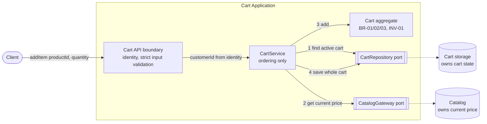
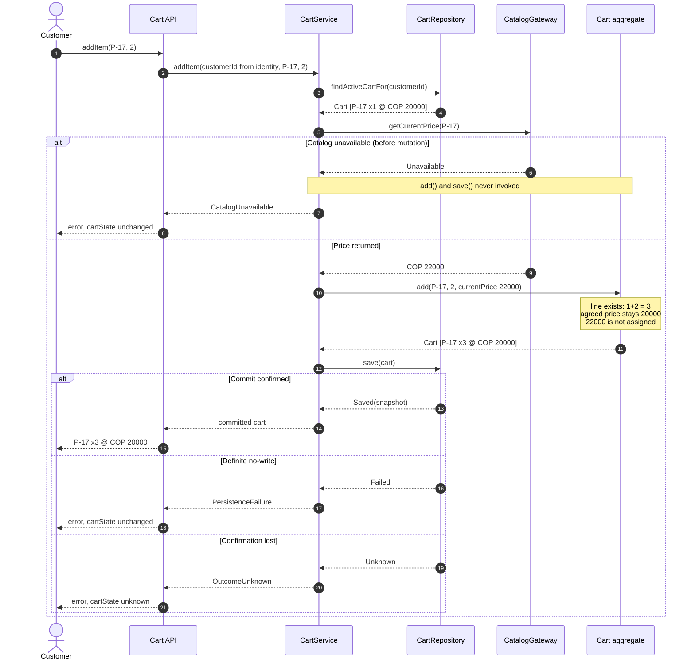
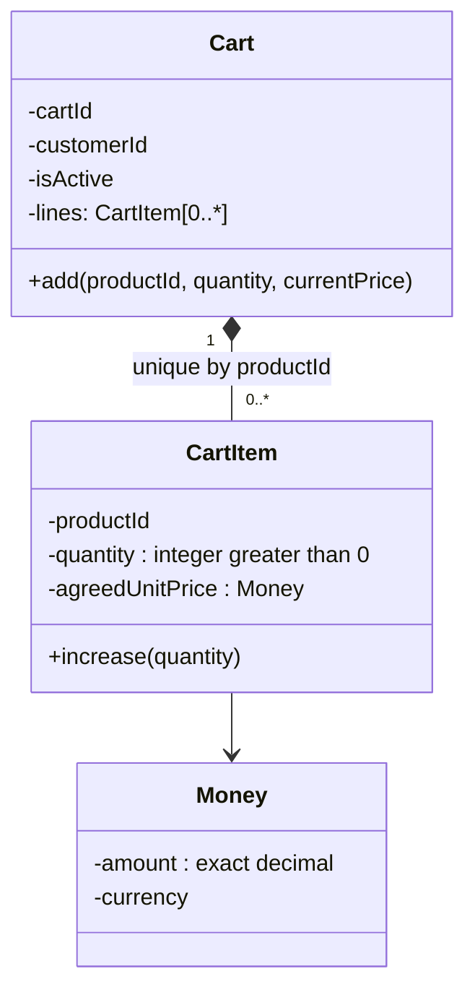

# claude - Technical Design Doc (Consolidated Candidate): Add Product to Cart

| Field | Value |
|---|---|
| Status | **CANDIDATE for independent review.** Not approved, not implemented, not tested. |
| Date | 2026-10-20 |
| Basis | Three independent proposals (Claude, Codex, Cursor) reviewed against the approved baseline. Decisions D-01..D-08 were approved one by one by the responsible engineer. See `claude-human-engineering-decision-log.md`. |
| Baseline | `input/Class15_AI_Challenge_Guide_v1.md` |

**Labels.** `APPROVED` = approved requirement. `DECISION Dn` = engineering decision approved in the review log. `PROVISIONAL` = proposed here, **not** reviewed. `ASSUMPTION` = relied upon, unverified. `OPEN` = unresolved question, not a requirement.

---

## A. Context and Problem

An authenticated customer has an active cart containing P-17, quantity 1, agreed unit price COP 20,000. The customer adds 2 units. Catalog reports COP 22,000. Expected result: one P-17 line, quantity **3**, agreed unit price **COP 20,000**. If Catalog is unavailable before mutation, the cart remains unchanged. No concurrent requests are assumed (APPROVED baseline).

The operation touches three facts that must not be merged: the price already agreed on the line, the current Catalog price, and anything the client claims about price or identity. The engineering problem is to order Catalog access, cart rules and persistence so that BR-01..03, FC-01, INV-01 and SEC-01/02 hold together, including when the persistence outcome is uncertain.

## B. Goals

| Goal | Requirement |
|---|---|
| Add a product to the authenticated customer's active cart | FR-01, SEC-01 |
| Return the updated (confirmed) cart | FR-02 |
| Existing product: increase quantity, keep a single line | BR-01, BR-02 |
| Existing line keeps its agreed unit price | BR-03 |
| Catalog unavailable before mutation: cart unchanged | FC-01 |
| Only positive quantities persisted | INV-01 |
| No client-provided price or userId is authoritative | SEC-01, SEC-02 |

## C. Non-Goals

- Stock checks, maximum quantity, cart expiration (all OPEN).
- Cart creation, checkout, payment, discounts, repricing.
- Concurrency control and idempotency (DECISION D7).
- Choice of database engine, framework, or deployment topology.
- A reconciliation read endpoint (`GET /cart`, DEFERRED).

## D. Design Considerations

- BR-02, BR-03 and INV-01 are rules over the set of lines in a cart, so one component must see the whole cart.
- INV-01 speaks about **persisted** state, so the store itself must guard it (DECISION D3).
- FC-01 is a conditional ("if Catalog is unavailable..."). It does not by itself force a Catalog call on increments. DECISION D1 adopts the call on every `addItem` because the baseline presents "Catalog unavailable → unchanged" next to the P-17 scenario, and this is the only option that makes that result demonstrable on it.
- SEC-01/02 require that the interface cannot express an authoritative `userId` or price.

**Assumptions**

| ID | Assumption |
|---|---|
| A-01 | Trusted authentication supplies a verified customer identity the request cannot override. |
| A-02 | Catalog distinguishes *unavailable* from *not found* and exposes a server-side price (contract unconfirmed). |
| A-03 | The store can commit a whole cart atomically, or report a definite or unknown outcome. |
| A-04 | Single currency (COP) and non-negative amounts. Unconfirmed. |
| A-05 | No concurrent requests (baseline). |

## E. Proposed Design

### E.1 Architecture (modular monolith with two ports)

One application, no new network service. Catalog and storage sit behind narrow ports.



| Component | Responsibility | Hides |
|---|---|---|
| Cart API boundary | Takes identity from the authentication context. Validates shape. Rejects any field other than `productId` and `quantity` (D4). Maps outcomes to responses. | Authentication mechanism, transport |
| CartService | Fixed order: find cart, ask Catalog, mutate, save, return confirmed snapshot. No business rules. | Sequencing |
| Cart aggregate | Only code that changes lines. Merge, one line per product, keep agreed price, quantity > 0. | Line collection |
| CatalogGateway | `getCurrentPrice(productId)`. Returns a typed result. | Catalog protocol, retries |
| CartRepository | Finds the active cart by customer. Saves the whole aggregate and reports a definite or unknown outcome. | Storage technology |

### E.2 Data ownership and state

- **Catalog** owns the current price. The cart never writes to Catalog.
- **The cart** owns lines, including each line's agreed unit price. It is copied from Catalog only when a line is created.
- State changes only inside `save`. Everything before it is read-only or in memory.

### E.3 Sequence



### E.4 Internal structure (only where it justifies D3)



`CartItem` has no way to set `agreedUnitPrice` after creation, and only `Cart` creates items. `Cart.add`: reject quantity < 1; if a line exists, increase its quantity and **ignore** `currentPrice`; otherwise create one line with `agreedUnitPrice = currentPrice`.

### E.5 Failure handling

| Outcome | Where detected | Cart state |
|---|---|---|
| Unauthenticated | API | unchanged |
| InvalidRequest (extra or missing field) | API | unchanged |
| InvalidQuantity (< 1, not integer, overflow) | API and aggregate | unchanged |
| ActiveCartNotFound | Repository | unchanged |
| ProductNotFound (PROVISIONAL) | Gateway | unchanged |
| CatalogUnavailable | Gateway, before mutation | unchanged |
| PersistenceFailure (definite no-write, read failure, or more than one active cart) | Repository | unchanged |
| OutcomeUnknown (write may have committed) | Repository | **unknown** |

### E.6 Security in the flow
The cart is chosen from the authenticated identity alone. The interface has no price and no user, customer or cart identifier (D4). New-line prices come from Catalog on the server.

## F. Interface Contract: `addItem`

Logical signature: `addItem(productId, quantity) → CommittedCart | Failure`, inside an authenticated context.

| Aspect | Definition |
|---|---|
| Inputs | `productId` (non-empty, matched exactly), `quantity` (integer ≥ 1, a **delta**). Implicit: verified customer identity. Not inputs: userId, customerId, cartId, price. |
| Output | Committed cart: `cartId`, items of `{productId, quantity, agreedUnitPrice{amount, currency}}`. Customer identity is not returned (PROVISIONAL). |
| Preconditions | Authenticated. Valid input. The customer has exactly one active cart. Catalog answers with a usable price. |
| Postcondition, line exists | Quantity = previous + `quantity`. Agreed price unchanged. Still exactly one line for the product. Other lines unchanged. |
| Postcondition, no line | One new line with the requested quantity and agreed price = Catalog price at that moment. Other lines unchanged. |
| Success | Returned only after commit confirmation. The returned cart is the committed snapshot. |
| Invariants | INV-01: persisted quantity > 0. BR-02: unique `(cartId, productId)`. A line's agreed price is never changed by `addItem`. |
| Failure | Outcomes in E.5. `cartState` is `unchanged`, except `OutcomeUnknown` which is `unknown`. |
| Retry guidance (D7) | Not idempotent: a repeated accepted call adds the quantity again. Clients must **not** replay automatically after a timeout, a lost response or `OutcomeUnknown`. A user-initiated retry is acceptable after `CatalogUnavailable` or `PersistenceFailure` reporting `unchanged`. |

## G. Data Model (logical, technology-neutral)

```mermaid
erDiagram
    CART ||--o{ CART_ITEM : contains
    CART {
        id cartId PK
        id customerId
        boolean isActive
    }
    CART_ITEM {
        id cartId PK_FK
        id productId PK
        integer quantity "greater than 0"
        decimal agreedUnitAmount "exact decimal"
        string currency
    }
```

| Rule | Where | Source |
|---|---|---|
| One line per product per cart | Composite key `(cartId, productId)`, enforced by the **store** and by the aggregate | BR-02, D3 |
| Quantity > 0 | Aggregate guard **and** a store-level obligation | INV-01, D3 |
| Agreed price written at line creation, never overwritten by an increment | Increment write path touches `quantity` only | BR-03 |
| Cart owner | `customerId`, copied from the authenticated identity | SEC-01 |
| "Active" | `isActive` boolean. Zero active carts → `ActiveCartNotFound`. More than one → `PersistenceFailure` without choosing. | D6, D8 |
| Money | Exact decimal plus currency. Never binary floating point. Scale and precision to be agreed with the Catalog contract. | D5 |

Not stored: Catalog's current price, product details, stock, maximum quantity, expiration, timestamps. A numeric quantity ceiling is an implementation detail, not part of the model.

After the scenario: `(C-42, P-17, 3, 20000, COP)`, replacing `(C-42, P-17, 1, 20000, COP)`.

## H. API Contracts

### H.1 External API (HTTP + JSON, PROVISIONAL mapping)

`POST /cart/items`. No cart or customer identifier in the path or body.

| Field | Rule |
|---|---|
| `productId` | Required string. |
| `quantity` | Required JSON integer ≥ 1. |
| Any other field | Rejected with 400 (D4). |

Request:
```json
{ "productId": "P-17", "quantity": 2 }
```
Success `200 OK`, same code for a new or an existing line:
```json
{
  "cartId": "C-42",
  "items": [
    { "productId": "P-17", "quantity": 3,
      "agreedUnitPrice": { "amount": "20000", "currency": "COP" } }
  ]
}
```
Amounts are base-10 strings. Error envelope: `{ "error": { "code", "message", "cartState" } }`.

| HTTP | code | cartState |
|---|---|---|
| 400 | InvalidRequest | unchanged |
| 400 | InvalidQuantity | unchanged |
| 401 | Unauthenticated | unchanged |
| 404 | ActiveCartNotFound | unchanged |
| 404 | ProductNotFound (PROVISIONAL) | unchanged |
| 503 | CatalogUnavailable | unchanged |
| 500 | PersistenceFailure | unchanged |
| 503 | OutcomeUnknown | **unknown** |

HTTP statuses are a proposed mapping and were not reviewed. Error messages must not expose storage details or other customers' data.

### H.2 Internal ports

| Port operation | Input | Result |
|---|---|---|
| `CatalogGateway.getCurrentPrice` | `productId` | `Found{productId, unitPrice: Money}`, `NotFound`, or `Unavailable`. Read-only. Must not report `Unavailable` as `NotFound` (A-02). |
| `CartRepository.findActiveCartFor` | `customerId` | `Cart`, `None`, or `Failure` (including more than one active cart). Never returns another customer's cart. |
| `CartRepository.save` | `Cart` | `Saved(snapshot)` after confirmed commit, `Failed` for a definite no-write, or `Unknown` when commit cannot be determined. Rejects duplicate `(cartId, productId)` and quantity ≤ 0 even if the aggregate is bypassed (D3). |

## I. Alternatives Considered

| Decision | Chosen | Alternatives | Why chosen | Reconsider if |
|---|---|---|---|---|
| D1 Catalog use | Consult on every `addItem` | Only for new lines; tolerate outage on increments | Makes the baseline scenario pair demonstrable. Cheap to reverse. | Stakeholders want increments to survive a Catalog outage |
| D2 Persistence outcome | Saved / Failed / Unknown | Binary; plus `GET /cart` | Avoids promising "unchanged" when unknown | The store resolves every commit to a known state |
| D3 Rule enforcement | Aggregate **and** store obligation | Aggregate only; rules in the service | INV-01 concerns persisted state | No viable store can enforce constraints |
| D4 Extra fields | Reject any | Reject only sensitive; ignore | One closed contract. Loosening later is compatible. | Existing clients send extra fields |
| D5 Money | Exact decimal + currency | Integer whole units; minor units + exponent | Does not assume scale 0 | Catalog guarantees integer amounts in one currency |
| D6 No active cart | Fail, do not create; ambiguity is `PersistenceFailure` | Own ambiguity code; implicit creation | Creation is unapproved policy | Stakeholders approve creation |
| D7 Concurrency and retries | Out of scope, with client guidance | Version field; idempotency key | No requirement | Concurrency or automatic retries appear |
| D8 Active cart | `isActive` boolean | None; status enum | Minimum needed to detect zero or many | Expiration defines more states |

Also rejected: repricing an existing line (violates BR-03), a second line per price (violates BR-02), a microservice split (no requirement), accepting a client price (SEC-02). No performance figures are claimed.

## J. Trade-offs

| Gains | Accepted consequences |
|---|---|
| Rules in one place; ports isolate Catalog and storage | Two interfaces to maintain |
| A contract that never promises more than it can know | An extra outcome and `cartState` field; no supported reconciliation yet |
| Invariants guarded in two layers | Constrains acceptable storage |
| Predictable agreed price for the customer | The price can drift from Catalog; reconciliation belongs to a later step |
| Simplicity: one deployable, no new infrastructure | Increments depend on Catalog availability; no concurrency or idempotency answer |

## K. Security and Privacy

| Requirement | How |
|---|---|
| SEC-01 | Cart found by the authenticated identity only. No user, customer or cart identifier is accepted. A forged field returns 400. |
| SEC-02 | No price field exists. New-line prices come from Catalog on the server. Existing lines keep persisted terms. |

To confirm: authentication cannot be spoofed (A-01). Catalog is a trusted server-side source. Logs avoid tokens and full carts. Errors do not reveal other customers' data.

## L. Risks and Open Questions

**Open business questions (stakeholders)**

1. Is a stock check required, and when: at add, at checkout, or both?
2. Is there a maximum quantity?
3. What is the expiration policy, and therefore what does "active" mean?
4. Must increments succeed while Catalog is down? (would reopen D1)
5. What should happen if Catalog does not know the product during an increment?
6. Should `addItem` create the cart when none exists?
7. Do retries or idempotency matter to the business?
8. Single currency, decimal scale, and non-negative amounts?
9. Do existing clients send extra fields? (affects D4)

**Technical risks**

| Risk | Consequence | Needed |
|---|---|---|
| Store atomicity and constraints not demonstrated | FC-01-style "unchanged" and INV-01 unproven | Choose a store and review it against H.2 |
| Catalog contract unconfirmed (A-02) | Outage and not-found cannot be told apart | Confirm contract |
| No supported way to resolve `OutcomeUnknown` | Customers may retry blindly | Decide on `GET /cart` or idempotency |
| Increment write path must not touch price | BR-03 not enforceable by constraint | Tests on the write path |
| Sequential retries duplicate quantity | Wrong cart contents | Client guidance (D7) |

**Items not yet reviewed (PROVISIONAL)**: unknown-product handling and invalid Catalog responses, whether the response exposes `customerId`, HTTP status mapping and API versioning, non-negative amounts.

## M. Design Review Checklist

| Req | Satisfied by | Evidence in design | Gap |
|---|---|---|---|
| FR-01 | E.3 flow | Sequence | Not run |
| FR-02 | Committed snapshot (F) | Contract | Needs a store that confirms commit |
| BR-01 | `Cart.add` | E.4, walkthrough | none |
| BR-02 | Composite key, aggregate | G | Store enforcement unproven (D3) |
| BR-03 | `Cart.add` ignores `currentPrice` | Walkthrough | Write path tests needed |
| FC-01 | Catalog before `add` and `save` | Sequence `alt` | Holds by ordering. Depends on D1 reading of the baseline. |
| INV-01 | Aggregate guard + store obligation | G, H.2 | Store enforcement unproven |
| SEC-01 | No identifier input, identity lookup | F, K | Depends on A-01 |
| SEC-02 | No price input | F, K | none |

Contradictions with approved requirements: none found. Missing evidence: no implementation, no tests, no confirmed Catalog contract, no chosen store.

### Required validation (design level, not executed)

**Scenario 1.** Cart P-17 × 1 @ 20,000. `addItem(P-17, 2)`: identity selects the cart, Catalog returns 22,000, `Cart.add` finds the line and makes it 1 + 2 = **3**, the price is not replaced, `save` returns `Saved`, the committed cart is returned. Result: **P-17 × 3 @ COP 20,000, one line.**

**Scenario 2.** Same start. Catalog returns `Unavailable`. `CartService` stops. `add` and `save` are never called. The persisted cart is still **P-17 × 1 @ 20,000.**

**Scenario 3 (added by D2).** Scenario 1 up to `save`, and commit confirmation is lost. Result: `OutcomeUnknown`, `cartState: unknown`. The design makes **no** claim about the stored cart.

**Gaps.** Scenario 2 holds by ordering and by `findActiveCartFor` having no side effects (an obligation on the store, not shown). Scenarios 1 and 3 depend on the store honouring H.2. Nothing has been implemented or tested.

## N. Traceability to the review log

| Decision | Status | Section |
|---|---|---|
| D1 Catalog on every `addItem` | ACCEPTED | D, E.3, I |
| D2 `OutcomeUnknown`; `GET /cart` DEFERRED | ACCEPTED / DEFERRED | E.3, E.5, F, H.2 |
| D3 Aggregate + store obligation | ACCEPTED | G, H.2 |
| D4 Closed contract | ACCEPTED | E.1, H.1 |
| D5 Exact decimal money | ACCEPTED | G, H.1 |
| D6 No cart: fail; ambiguity → `PersistenceFailure` | ACCEPTED | E.5, G |
| D7 Concurrency and retries out of scope | ACCEPTED | C, F |
| D8 `isActive` boolean | ACCEPTED | G |

---

## Design decisions requiring review
D1 (availability coupling and its baseline reading), D2 (no reconciliation path), D3 (store obligations), D5 (decimal scale), plus the PROVISIONAL items in L.

## Open questions requiring stakeholder input
The nine questions in L.

## Engineering self-review
- All nine approved requirements are met **on paper**. No implementation or test result is claimed.
- The weakest point is D1: its justification is a reading of the baseline, not the literal text of FC-01.
- Atomicity and constraints depend on a store that has not been chosen. The Catalog contract is unconfirmed.
- `OutcomeUnknown` is honest but unresolved for clients until reconciliation or idempotency is decided.
- Unresolved business questions stay as questions. Nothing was promoted to a requirement.
- This candidate is ready for independent review once the PROVISIONAL items are reviewed. It is not ready for implementation.
