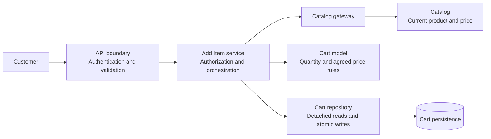
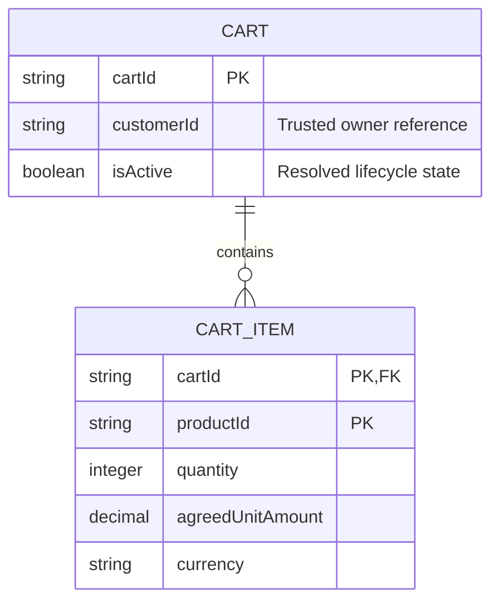

# Technical Design Doc: Add Product to Cart

**Status:** Proposal for peer review, not an approved implementation. No application code has been implemented or tested. Audience: the engineering team reviewing the Add Product to Cart capability.

**Documentation basis:** Decisions, alternatives, and trade-offs support collaborative review as described in [Software Engineering at Google, Chapter 10](https://abseil.io/resources/swe-book/html/ch10.html). Responsibility boundaries apply abstraction, information hiding, cohesion, and limited coupling from the [SWEBOK v4 Software Design knowledge area](https://ieeecs-media.computer.org/media/education/swebok/swebok-v4.pdf). The approved case is recorded in the [classroom baseline](../input/Class15_AI_Challenge_Guide_v1.md).

## A. Context and Problem

**APPROVED REQUIREMENTS:** An authenticated customer can add products to an active cart and receive its updated state. Adding an existing product increases its quantity, preserves its agreed unit price, and retains exactly one line for that product.

P-17 already has quantity 1 at COP 20,000. Adding 2 must produce quantity 3 at COP 20,000 even though Catalog reports COP 22,000. The engineering problem is to coordinate authorization, Catalog access, cart rules, and persistence without repricing or partial state.

**PROPOSED DESIGN DECISION:** Consult Catalog before every cart mutation, including an existing-line increase. Use its price only when creating a new line. This makes the required outage scenario explicit; FC-01 alone does not require a Catalog call on every addition. That stronger dependency is a proposal requiring review.

## B. Goals

Approved requirement traceability:

| Outcome | Approved requirements |
|---|---|
| Add products and return the committed cart | FR-01, FR-02 |
| Increase quantity without duplicate lines | BR-01, BR-02 |
| Preserve the existing agreed price | BR-03 |
| Leave the cart unchanged on Catalog failure before mutation | FC-01 |
| Persist only positive quantities | INV-01 |
| Determine cart ownership from authenticated identity | SEC-01 |
| Use authoritative server-side pricing | SEC-02 |

## C. Non-Goals

Stock checks, reservations, maximum business quantity, and cart expiration remain unresolved. Checkout, payment, discounts, and deliberate repricing are outside scope. Concurrency control and retry deduplication need separate design before supporting overlapping or automatically retried requests.

## D. Design Considerations

**ASSUMPTIONS:** Requests do not overlap; existing persisted carts satisfy the invariants; authentication provides a verified customer identity; the active-cart resolver identifies one owned active cart; persistence supports atomic commit and rollback.

**PROPOSED DESIGN DECISIONS:** Use logical modules in one application without requiring microservices, a particular framework, or a database engine. Represent money exactly as amount and currency. Accept positive integer increments and reject arithmetic overflow. A representation limit is not an approved maximum business quantity.

Cart owns agreed prices and quantity rules. Catalog owns current product information. The application service owns ordering, and the repository hides storage details. These boundaries keep business rules cohesive while limiting dependency coupling.

## E. Proposed Design

**Responsibilities:** The API authenticates and validates request shape. The application service resolves the customer's cart and coordinates dependencies. The Cart model encapsulates quantity, uniqueness, and agreed-price rules. The repository loads detached state and saves atomically. The Catalog gateway translates integration-specific failures into typed outcomes.



**State management:** Items are keyed by product ID within the cart; callers cannot directly edit the collection. An existing item receives only a quantity increment. A new item receives the requested quantity and authoritative Catalog price. Unrelated lines remain unchanged.

Persistence enforces uniqueness of `(cartId, productId)` and positive quantities using constraints or equivalent guarantees, including for other write paths. A save is atomic. No shared mutable cart cache is assumed. Repository save returns the committed snapshot only after commit confirmation.

**Ordering:** Authenticate and validate, load the owned active cart, call Catalog, mutate detached state, save atomically, and return the committed snapshot. Missing or malformed Catalog data fails before mutation.

```mermaid
sequenceDiagram
    actor Customer
    participant API
    participant Service as Add Item service
    participant Repo as Cart repository
    participant Catalog
    participant Cart as Detached cart
    Customer->>API: addItem(P-17, 2)
    API->>API: Verify identity and validate input
    API->>Service: addItem(authenticatedCustomer, P-17, 2)
    Service->>Repo: loadActiveForCustomer(authenticatedCustomer)
    Repo-->>Service: Owned cart: P-17, 1, COP 20000
    Service->>Catalog: getProduct(P-17)
    alt Catalog unavailable
        Catalog-->>Service: CatalogUnavailable
        Service-->>API: Failure; no mutation or save
        API-->>Customer: CatalogUnavailable; cart unchanged
    else Catalog succeeds
        Catalog-->>Service: P-17, current price COP 22000
        Service->>Cart: Add 2; preserve agreed price
        Cart-->>Service: One P-17 line: 3, COP 20000
        Service->>Repo: saveAtomically(authenticatedCustomer, updatedCart)
        Repo-->>Service: Commit confirmed; saved snapshot
        Service-->>API: Updated cart
        API-->>Customer: One P-17 line: 3, COP 20000
    end
```

### Data model

**PROPOSED DESIGN DECISION:** Use the following logical model, independent of database engine. Cart is the aggregate boundary; CartItem belongs to exactly one Cart. Customer and Product are external identities, not duplicated customer or catalog records.



| Entity / value | Attribute | Type and constraint | Ownership / meaning |
|---|---|---|---|
| Cart | cartId | Nonempty opaque string; primary key | Cart identity, assigned by the server |
| Cart | customerId | Nonempty opaque string; required | Reference to the authenticated customer's identity |
| Cart | isActive | Required boolean | Existing lifecycle state; this operation does not change it or define expiration |
| CartItem | cartId, productId | Composite primary key; cartId references Cart | Enforces at most one product line per cart; productId references Catalog logically |
| CartItem | quantity | Integer from 1 through 9,007,199,254,740,991 | Positive stored quantity; the upper bound is a proposed JSON interoperability limit, not a business cap |
| CartItem | agreedUnitAmount | Exact nonnegative decimal | Agreed unit amount captured when the line is created; immutable during quantity increases |
| CartItem | currency | Three uppercase letters | Currency of the agreed amount; COP in the required scenario |
| Money | amount, currency | Decimal string and currency string at API boundaries | Value object, not an independent persisted entity |

All fields are required and non-null. Persist decimal amounts exactly, never through binary floating point. Decimal precision and currency-specific scale must be agreed with the Catalog integration before physical schema implementation; no rounding is introduced by this operation. Nonnegative amounts are a proposed validation rule, not an additional approved business requirement.

The cart has zero or more items. Each item has exactly one parent cart. The composite key eliminates the need for a separate item ID. The repository must reject duplicate product keys and nonpositive quantities even when writes bypass the Cart model. Active-cart lookup must return zero or one cart; multiple matches fail without mutation as `PersistenceFailure` rather than selecting arbitrarily. This does not define a broader cart lifecycle policy.

For the required example, the persisted item changes from `(C-42, P-17, 1, 20000, COP)` to `(C-42, P-17, 3, 20000, COP)`. Catalog's current amount `22000` is not written over the agreed amount. Product and customer references do not imply cross-service database foreign keys.

## F. Interface Contract

**Operation:** `addItem(authContext, productId, quantityToAdd) → UpdatedCart | Failure`. Trusted authentication infrastructure supplies `authContext`. The client supplies only product ID and quantity increment; client identity and price fields are rejected. This rejection is a proposed contract choice, stronger than merely ignoring untrusted fields.

**Output:** Committed cart identifier and items containing product ID, quantity, agreed unit amount, and currency. The following HTTP binding and internal interfaces are proposed contracts, not existing deployed APIs.

Contract details:

| Aspect | Definition |
|---|---|
| Preconditions | Verified customer; owned active cart; valid product identifier; positive integer increment; representable resulting quantity |
| Catalog boundary | Matching product ID and authoritative current price, or typed failure; no cart mutation |
| Existing line | Increase quantity by the increment; preserve agreed price |
| New line | Create exactly one line using the increment and Catalog price |
| Invariants | At most one line per product per cart; persisted quantities greater than zero |
| Other state | Unrelated lines unchanged |
| Success | Return committed state only after confirmed persistence |

**PROPOSED FAILURE OUTCOMES:** `Unauthenticated`, `InvalidInput`, `ActiveCartNotFound`, `ProductNotFound`, `CatalogUnavailable`, `InvalidCatalogResponse`, and `PersistenceFailure`. Pre-mutation failures leave stored state unchanged. A definite write rollback also leaves stored state unchanged.

A lost commit acknowledgment produces `OutcomeUnknown`, not a claim of rollback. Refresh the cart and reconcile before deciding whether to submit another addition; refreshing does not itself provide deduplication. The operation is additive and is not inherently idempotent.

### Public API

**Add items:** `POST /api/v1/cart/items`. The server resolves the active cart from the authenticated identity; neither the path nor body accepts customerId or cartId. The authentication mechanism is supplied by the host application; credentials are not request-body fields. Request and response bodies use `application/json`.

| Request field | Contract |
|---|---|
| productId | Required nonempty string; opaque and matched exactly, without case conversion |
| quantityToAdd | Required JSON integer between 1 and 9,007,199,254,740,991; reject if the resulting quantity exceeds this representation limit |
| Additional fields | Reject, including userId, customerId, cartId, price, and unitPrice |

Request for the approved scenario:

```json
{
  "productId": "P-17",
  "quantityToAdd": 2
}
```

Return `200 OK` for both a new and existing line, with the complete committed cart snapshot. Array order is unspecified and product IDs are unique. The response excludes customer identity and does not imply a stock reservation.

```json
{
  "cartId": "C-42",
  "items": [
    {
      "productId": "P-17",
      "quantity": 3,
      "agreedUnitPrice": {
        "amount": "20000",
        "currency": "COP"
      }
    }
  ]
}
```

Money amounts are ordinary base-10 strings with no separators or exponent, such as `"20000"` or `"20000.50"`. Clients compare decimal values, not formatting. Responses use `Cache-Control: no-store` because cart state is customer-specific.

**Read for reconciliation:** `GET /api/v1/cart` returns `200 OK` with the same cart representation, resolved from the same authenticated identity, without contacting Catalog or changing agreed prices. It accepts no customer/cart selector. Failures are `Unauthenticated`, `ActiveCartNotFound`, or `PersistenceFailure`, using the mappings below. This supporting read permits a refresh after an unknown write outcome; it does not make retries idempotent.

### Error contract

Every application error uses the same envelope. `cartState` is `unchanged` when this request made no persisted change and `unknown` when commit cannot be determined. `message` is descriptive; clients branch on `code`. For read failures, `cartState` is `unchanged` because the read performs no writes.

```json
{
  "error": {
    "code": "CatalogUnavailable",
    "message": "Catalog is temporarily unavailable.",
    "cartState": "unchanged"
  }
}
```

| HTTP status | Error code | Condition | cartState |
|---|---|---|---|
| 401 | Unauthenticated | Missing or invalid authenticated identity | unchanged |
| 400 | InvalidInput | Invalid JSON, missing/unknown fields, invalid quantity, or overflow | unchanged |
| 404 | ActiveCartNotFound | No active cart for the authenticated customer | unchanged |
| 404 | ProductNotFound | Catalog authoritatively reports no such product | unchanged |
| 503 | CatalogUnavailable | Catalog timeout or unavailable dependency before mutation | unchanged |
| 502 | InvalidCatalogResponse | Wrong product ID, missing fields, or invalid authoritative money | unchanged |
| 500 | PersistenceFailure | Read failure, invalid persisted state, or definite write rollback | unchanged |
| 503 | OutcomeUnknown | Write may have committed but confirmation was lost | unknown |

Do not automatically replay POST on timeout, `OutcomeUnknown`, or a lost HTTP response: a lost response may follow a successful commit even if no error envelope was received. A known `CatalogUnavailable` response permits a user-initiated retry because no write occurred. Errors must not expose storage details, credentials, or another customer's identifiers.

### Internal API boundaries

These are logical interfaces within the application, not requirements for new HTTP services. All return typed results; adapters translate infrastructure exceptions without misreporting an uncertain commit as rollback.

| Interface | Input | Success | Failures and guarantees |
|---|---|---|---|
| AddItemService.addItem | Trusted authContext, productId, quantityToAdd | Committed UpdatedCart matching the public response | Errors above; enforces the stated ordering and owner scope |
| CatalogGateway.getProduct | productId | `{productId, currentUnitPrice: {amount, currency}}` | ProductNotFound, CatalogUnavailable, InvalidCatalogResponse; no cart writes; product ID must match request |
| CartRepository.loadActiveForCustomer | Customer identity derived from authContext | Detached Cart, including owner, active state, and items | ActiveCartNotFound or PersistenceFailure; never return another customer's cart |
| Cart.addItem | productId, positive increment, verified Catalog Money | Updated detached Cart | InvalidInput for quantity/overflow; preserve existing price; no I/O |
| CartRepository.saveAtomically | Trusted customer identity and detached Cart | Committed cart snapshot | PersistenceFailure only for a definite no-write/rollback outcome; OutcomeUnknown for uncertain commit; validate owner, active state, uniqueness, and quantities |

The save interface receives the trusted owner scope separately from mutable cart data, consistent with the sequence. Cart mutations remain invisible to other readers until commit. Catalog's proposed response for P-17 is `{productId: "P-17", currentUnitPrice: {amount: "22000", currency: "COP"}}`; its current price is used only for a new line.

## G. Alternatives Considered

Alternatives and decision rationale:

| Alternative | Advantages | Disadvantages and constraints | Decision and reconsideration evidence |
|---|---|---|---|
| Selected: Catalog before every mutation | Uniform ordering; directly demonstrates FC-01; separates current and agreed prices | Existing-line additions depend on Catalog availability | Select for review; revisit if stakeholders approve outage-tolerant existing-line additions |
| Skip Catalog for existing lines | Fewer dependency calls; increases work during Catalog outages | Changes the proposed outage behavior; requires clarity on when Catalog is necessary | Defer pending explicit agreement; FC-01 alone does not prohibit this alternative |
| Place rules in API handler | Fewer initial abstractions | Couples transport, pricing, mutation, and persistence; harder to preserve rules across entry points | Reject for cohesion; revisit if existing conventions provide equivalent encapsulation |
| Persist, then consult Catalog and compensate | Allows an earlier tentative change | Exposes intermediate state and adds recovery logic; complicates unchanged-state guarantees | Reject for simplicity and FC-01; revisit only for an approved asynchronous workflow |

## H. Trade-Offs

Logical modules improve rule isolation and reviewability at the cost of explicit interfaces. Atomic persistence simplifies consistency but depends on storage guarantees that implementation must demonstrate. Reconsider the boundaries if integration evidence shows unnecessary indirection or a distinct deployment need.

Calling Catalog first avoids compensation and holding a write transaction across a dependency call, but accepts dependency latency and reduced availability. No performance measurements are claimed. Availability objectives or production dependency evidence could justify reconsideration.

Preserving agreed price makes BR-03 deterministic. Any future repricing policy requires separate approval and behavior; the add operation cannot silently introduce it.

## I. Security and Privacy

**SEC-01:** Resolve the active cart using verified customer identity. A caller-supplied customer ID cannot select or authorize a cart. Repository results must belong to the authenticated customer.

**SEC-02:** Exclude client prices from the contract. New lines use Catalog pricing; existing lines retain persisted agreed terms.

**ASSUMPTIONS REQUIRING CONFIRMATION:** Authentication prevents identity spoofing, Catalog is a trusted integration, and transport protects credentials and cart data. Record outcomes and correlation identifiers without logging tokens or full carts.

## J. Risks and Open Questions

Decisions and evidence still needed:

| Question or risk | Consequence | Required input |
|---|---|---|
| Whether and when to check stock | Cart admission does not guarantee availability | Stakeholders choose no check, add-time check, checkout check, or a combination; reservation is separate |
| Maximum quantity | No approved business cap | Stakeholders define any required limit |
| Cart expiration | Active status lacks a lifecycle policy | Confirm active-cart resolution and expiration policy |
| Catalog dependency for existing lines | Outages block increases | Review mandatory lookup as a technical decision |
| Multiple active carts or invalid legacy data | Selection or invariant enforcement can fail | Verify initial data and resolver assumptions before implementation |
| Retries and concurrency | Duplicate increments or lost updates outside this scenario | Define concurrency and idempotency requirements before expanding scope |

## K. Design Review Checklist and Validation

**Required success walkthrough:** Initially, one P-17 line has quantity 1 and agreed price COP 20,000. The service resolves the authenticated customer's cart. Catalog returns COP 22,000. The model finds the existing key and computes `1 + 2 = 3`, leaving price untouched. Atomic persistence saves one P-17 line at quantity 3 and COP 20,000. The response returns that committed snapshot.

**CatalogUnavailable walkthrough:** Catalog fails before detached-state mutation and before save. The service returns `CatalogUnavailable`. Stored state remains one P-17 line at quantity 1 and COP 20,000. This guarantee follows from operation ordering under the stated assumptions.

Planned validation, not executed application tests:

| Requirement | Review evidence and future validation |
|---|---|
| FR-01, FR-02 | Existing and new additions return the committed cart |
| BR-01, BR-03 | Required scenario yields quantity 3 at COP 20,000 |
| BR-02 | Exactly one product line; persistence rejects duplicate keys |
| FC-01 | Inject Catalog failure; verify no mutation or save and unchanged storage |
| INV-01 | Reject zero, negative, fractional, and overflowing increments; verify persistence enforcement |
| SEC-01 | Reject forged identity fields; attempt cross-customer access and verify no unauthorized modification |
| SEC-02 | Reject supplied prices; new lines use Catalog price and existing lines preserve agreed price |
| Failure handling | Verify definite rollback, malformed Catalog responses, and unknown commit outcomes |
| Data model | Verify composite-key uniqueness, parent references, exact decimal round trips, and rejection of invalid quantities |
| HTTP contracts | Verify POST/GET response schemas, error status/code/state mappings, strict request fields, and no-store responses |
| Reconciliation | Verify GET returns persisted state without Catalog access; no automatic replay after uncertain POST outcomes |

**Design decisions requiring review:** Logical module boundaries; mandatory Catalog lookup before mutation; preservation of agreed prices; logical Cart/CartItem model; exact money representation and nonnegative amount validation; technical quantity limit; atomic persistence and committed-snapshot response; HTTP endpoints, strict input fields, and error mappings. Confirm Catalog decimal precision and currency scale before selecting physical storage types.

**Open questions requiring stakeholder input:** Stock checks and timing, maximum quantity, expiration, and whether existing-line additions should remain possible during Catalog outages.

**Engineering self-review:** The proposed ordering demonstrates both required scenarios under explicit assumptions. Technical choices remain distinct from approved requirements; no stock or expiration policy is invented. Authentication, persistence atomicity, constraint enforcement, and response consistency still require implementation evidence. No application implementation or executed tests are claimed.
