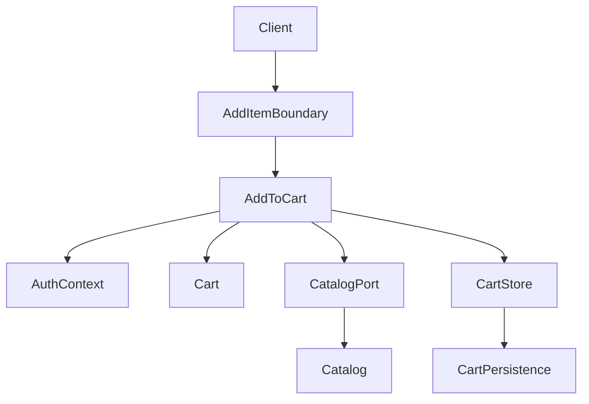
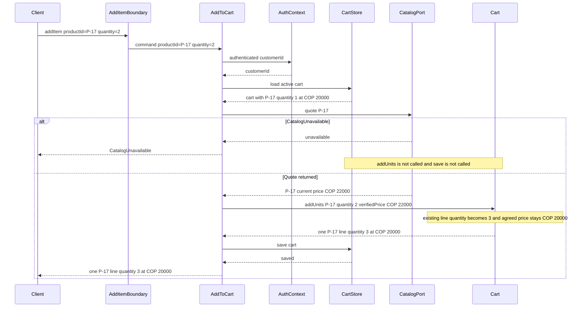
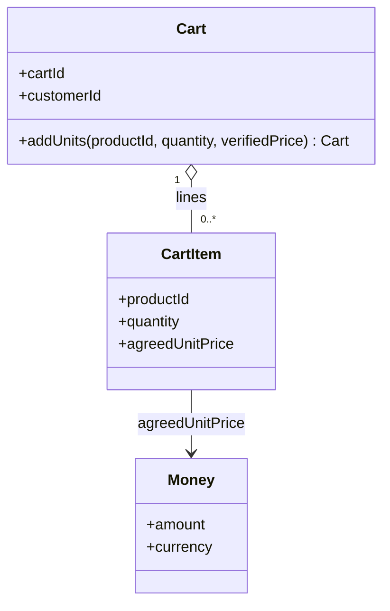

# Technical Design Doc: Add Product to Cart

| | |
|---|---|
| Status | Proposal for engineering review. Not an approved design and not an implementation. |
| Date | 2026-10-20 |
| Updated | 2026-10-20. Logical data model and API contracts added in sections L and M. |
| Capability | Add Product to Cart |
| Scope of this review | One application, one `addItem` operation, the logical data model, the external and port contracts, and the P-17 scenario below |

This document follows the design-doc practice in *Software Engineering at Google*, Chapter 10: a reviewable record of the problem, the proposed decision, the alternatives, and the trade-off. It uses the Software Design knowledge area of SWEBOK Guide v4 for abstraction, modularity, information hiding, cohesion, coupling, and explicit design rationale.

Nothing in this document has been implemented or tested. Where a guarantee depends on a property this proposal does not demonstrate, the gap is named.

## How to read labels

| Label | Meaning |
|---|---|
| APPROVED REQUIREMENT | Given as binding for this proposal. |
| PROPOSED DESIGN DECISION | An engineering choice offered for review. It is not a new business policy. |
| ASSUMPTION | Something this proposal relies on that is not an approved requirement. |
| OPEN QUESTION | Unresolved. This proposal does not treat it as approved. |

## A. Context and Problem

### Business capability

An authenticated customer has an active shopping cart. The capability under design is adding units of a product to that cart and returning the cart that results.

APPROVED REQUIREMENT. The customer can add a product to an active shopping cart (FR-01). After success, the caller receives the updated cart state (FR-02).

### Scenario this proposal must explain

The cart already contains one line:

- Product P-17
- Quantity 1
- Agreed unit price COP 20,000

The customer requests two additional units of P-17. Catalog reports the current price of P-17 as COP 22,000.

The required successful result is one cart line:

- Product P-17
- Quantity 3
- Agreed unit price COP 20,000

ASSUMPTION. This scenario has no concurrent requests. The proposal does not establish behavior if that assumption is removed.

A second required outcome: if Catalog is unavailable before the cart is mutated, the persisted cart stays as it was (FC-01).

### Engineering problem

The operation looks like a quantity update. It is also a boundary problem among three facts that must not be collapsed into one price:

- The cart already stores an agreed unit price for P-17.
- Catalog stores a current price, and that price is different.
- A client may attempt to send a price or a user id. Neither is an authority for this operation.

APPROVED REQUIREMENT. Adding a product that is already in the cart increases that line's quantity (BR-01). The cart has at most one line for a given product (BR-02). Increasing the quantity preserves the line's agreed unit price (BR-03). A persisted cart line has quantity greater than zero (INV-01). The authenticated identity selects the cart (SEC-01). A caller-supplied user id is not authorization. A client-supplied price is not authoritative (SEC-02).

The design has to show a single sequence in which those rules remain true together, including when Catalog does not respond.

### What is already decided, and what this document proposes

The identifiers FR-01, FR-02, BR-01, BR-02, BR-03, FC-01, INV-01, SEC-01, and SEC-02 are approved requirements. They are restated in sections B and D. They are not redesign candidates in this proposal.

Component split, the shape of `addItem`, the moment Catalog is called, where the agreed price lives, and the failure outcomes are proposed design decisions. Stock, maximum quantity, and cart expiration are open questions. They appear in sections C and J and are not given requirement identifiers here.

## B. Goals

The proposal is acceptable only if a reviewer can trace each outcome below to an approved requirement.

1. An authenticated customer can add units of a product to that customer's active cart (FR-01, SEC-01).
2. A successful call returns the cart state that was saved (FR-02).
3. When the product already has a line, the saved quantity is the previous quantity plus the requested quantity (BR-01). For the scenario, 1 + 2 = 3.
4. The saved cart contains one line for that product (BR-02).
5. The agreed unit price on that existing line remains the price already stored. For the scenario, that price remains COP 20,000 while Catalog reports COP 22,000 (BR-03).
6. If Catalog is unavailable before mutation, no cart write occurs and the persisted cart is unchanged (FC-01).
7. The operation does not persist a line with quantity less than 1 (INV-01).
8. The cart is chosen from the authenticated identity. A user id in the request does not select the cart (SEC-01).
9. The request has no authoritative price. Where a new agreed price must be established, the price comes from a server-side Catalog quote (SEC-02).

Goal 9 covers the first time a product is added. The P-17 scenario is an increment, so BR-03 applies and no new agreed price is written. The general `addItem` contract still has to say where a first line's price comes from, because FR-01 is not limited to increments. That price source is decision D3 and is marked for review.

## C. Non-Goals

This proposal does not decide the following. They remain open questions from the business context:

- Whether stock or any other availability quantity must be checked.
- When such a check would run, if stakeholders later require one.
- A maximum permitted quantity.
- A cart expiration policy, including how long a cart stays active.

The proposal also stays outside these areas, because no approved requirement asks for them:

- Authentication login, session issuance, and credential storage. The proposal starts after an authenticated identity exists.
- Catalog's internal price-calculation rules. Catalog is a source of a quote. This proposal does not redesign Catalog.
- Checkout, payment, tax, discounts, promotions, and repricing at purchase time.
- Removing items, setting an absolute quantity, or editing the agreed price in place.
- Concurrent updates, idempotency keys, and client retries.
- A choice of framework, database engine, hosting topology, or a split into independently deployed services.
- Creating a business policy for stock reservation, cart lifetime, or quantity caps under another name.

PROPOSED DESIGN DECISION. `addItem` does not create a cart when the authenticated customer has none. Cart creation is a separate capability. Confirmation from stakeholders is requested in section J, because FR-01 speaks about an active cart and does not describe cart creation.

## D. Design Considerations

### Approved requirements that constrain the design

| ID | Constraint on the design |
|---|---|
| FR-01 | The operation adds units to an active cart of an authenticated customer. |
| FR-02 | Success returns the updated cart, so the returned state and the saved state are the same state. |
| BR-01 | The requested quantity is a delta. It is added to the existing quantity. It does not replace that quantity. |
| BR-02 | The write updates the existing line. It does not append a second line for the same product. |
| BR-03 | The agreed unit price is an attribute of the existing line. A newer Catalog price does not replace it during this operation. |
| FC-01 | Catalog is consulted before mutation. Unavailability ends the operation with no cart write. |
| INV-01 | The quantity that would be saved is an integer greater than zero. |
| SEC-01 | Cart selection uses the authenticated customer. A request field named as a user id is not the selector. |
| SEC-02 | The command does not carry an authoritative price. Server-side verification is required wherever a price is accepted into the cart. |

### Quality concerns

- **Consistency of the agreed price.** The line is a record of what was agreed when the product entered the cart. Mixing that record with Catalog's current price would make BR-03 false in the P-17 scenario.
- **Failure containment.** FC-01 is a statement about persistence. A read of the cart, a failed Catalog call, and an in-memory object that is later discarded must leave the stored cart as it was.
- **A closed command.** The safest contract is one that cannot express an unauthorized user id or an untrusted price. Ignoring extra fields would also satisfy the wording of SEC-01 and SEC-02. Rejecting them is the proposed choice, because a client that sends them is not using this contract (decision D2).
- **Cohesion.** Quantity, uniqueness of the product line, and preservation of the agreed price change together. They belong in one place: the cart.
- **Coupling.** The cart should depend on a price value, not on Catalog's retrieval mechanism. The use-case coordinator should depend on a quote operation, not on Catalog's internals.
- **Operability.** The proposal avoids a new service boundary. Operational risk stays in one application, at the cost of a later extraction if scale or ownership requires it (decision D1).

### Assumptions that influence the solution

- ASSUMPTION. No concurrent `addItem` calls affect this cart during the scenario. Uniqueness of the line is still a cart invariant, so a later concurrency design has a single rule to protect. This proposal does not specify locking or a version check.
- ASSUMPTION. The scenario's cart is the one active cart for the authenticated customer. The proposal can resolve it. Expiration is undefined, so "active" is not given a lifetime here.
- ASSUMPTION. Quantity is a positive whole number of units, as in the scenario values 1 and 2. Fractional quantity is outside the approved requirements.
- ASSUMPTION. Loading a cart performs no write and does not refresh agreed prices from Catalog.
- ASSUMPTION. Saving a cart either replaces the previous persisted cart with the updated cart, or it fails and leaves the previous cart in place. This proposal requires that property and does not choose a mechanism. Section "Scenario validation" records this as a demonstration gap.
- ASSUMPTION. For this scenario, Catalog and the cart use COP. The increment path does not read the quote's currency onto the line. Currency conversion is not part of the proposal.
- ASSUMPTION. An authentication mechanism, outside this capability, has already bound the caller to a customer identity that the application can read and that the caller cannot replace by a request field.
- ASSUMPTION. Catalog, reached through a port, is the server-side source of product identity and current price. This proposal places that port inside the same trust boundary as the cart use case. It does not require a network hop. If a later deployment splits them, that hop needs its own authentication. That split is not proposed here.

## E. Proposed Design

### E.1 Architectural approach

PROPOSED DESIGN DECISION (D1). The capability lives in one application with four module boundaries:

1. A request boundary that accepts `addItem`.
2. An application coordinator, `AddToCart`, that runs the use case in a fixed order.
3. A cart domain module that owns lines, quantities, and agreed prices.
4. Two ports: `CatalogPort` for a read-only quote, and `CartStore` for load and save. `AuthContext` exposes the authenticated customer id.

This is modularity without a microservice split. No approved requirement implies independent deployment, a specific framework, or a database engine. Introducing them would add coupling and operational surface with no requirement to justify it.

Why this approach: FR-01 through SEC-02 can be met by ordering a read, a quote, an in-memory rule, and a save. The team can review that order in one place.

Alternative considered: separate deployable services for cart and catalog. Rejected in D1. Reconsider if ownership, release cadence, or an explicit scalability requirement makes a network boundary necessary.

Trade-off accepted: Catalog unavailability is still visible as a failed quote, which FC-01 requires, without operating a second service.

Supported by: the absence of any requirement for a distributed deployment, and FC-01's need for a clearly ordered "before mutation" point.

### E.2 Component responsibilities

**AddItemBoundary.** Translates the call into a command of `productId` and `quantity`. It rejects a call that includes a price or a user id before the coordinator runs. It does not choose a cart, merge lines, or interpret Catalog prices. Information hiding: callers cannot reach `Cart.addUnits` directly.

**AuthContext.** Returns the customer id already established for the caller. It has no cart operations.

**AddToCart.** The only orchestrator. It reads the customer id, loads that customer's active cart, requests a Catalog quote, and only then asks the cart to add units and the store to save. It does not contain the line-merge rule. That rule is hidden in `Cart`, which keeps the coordinator from becoming a second implementation of BR-01, BR-02, and BR-03.

**Cart.** The aggregate for one customer's cart. `addUnits(productId, quantity, verifiedPrice)` is the only mutation this proposal uses.

- If a line for `productId` exists, quantity becomes previous quantity plus `quantity`. The agreed unit price already on the line stays in place. `verifiedPrice` is not assigned.
- If no line exists, one line is created. Its quantity is the requested quantity. Its agreed unit price is `verifiedPrice`, which the coordinator obtained from Catalog.
- The aggregate refuses a non-positive quantity and refuses to keep two lines for one product.

Cohesion is the reason for this shape. The three business rules and the quantity invariant are one state transition.

**CatalogPort.** One operation: quote a product id. Success returns a quote: product id, current unit price, and currency. Failure to obtain a response is `CatalogUnavailable`. The port does not read or write carts. Catalog's storage and price algorithm stay behind the port.

**CartStore.** `load` returns the active cart for a customer id and writes nothing. `save` persists a whole cart. The store does not reprice lines and does not call Catalog.

Coupling is one-directional. `Cart` accepts a `Money` value and has no type that represents Catalog. `AddToCart` depends on `CatalogPort` and `CartStore`, not on concrete retrieval or storage. `AddItemBoundary` depends on the command and on `AddToCart`.

### E.3 Component diagram



`Catalog` and `CartPersistence` are the capabilities behind the ports. This proposal specifies the port obligations. It does not specify their internals or a storage engine.

### E.4 Important interactions

For a structurally valid `addItem`, the coordinator uses this order. The order is part of the design, because FC-01 is about what has happened before mutation.

1. Read `customerId` from `AuthContext`.
2. `CartStore.load` the active cart for that customer. This read is not a mutation.
3. `CatalogPort.quote(productId)`.
4. On quote failure, return `CatalogUnavailable`. Do not call `Cart.addUnits`. Do not call `CartStore.save`. Drop the in-memory cart.
5. On a usable quote, call `Cart.addUnits`. For an existing line the quote price stays outside the line.
6. `CartStore.save` the cart returned by `addUnits`.
7. Return that saved cart (FR-02).

Structural rejection (unauthenticated caller, price present, user id present, invalid quantity) happens in the boundary or at the start of the coordinator, before the quote and before any save.

PROPOSED DESIGN DECISION (D4). The quote is an input to `addUnits`, and the aggregate decides whether that price is stored. Placing the Catalog call inside `Cart` was considered. It was rejected because it would couple the aggregate to an external module and would hide the FC-01 ordering inside the domain object. The coordinator owns ordering. The cart owns the pricing rule. Reconsider if the quote and the merge must be transactional across a boundary this proposal does not have.

### E.5 Sequence diagram

The diagram covers a structurally valid request. It includes the successful P-17 increment and the `CatalogUnavailable` outcome. Early rejections do not reach this sequence.



### E.6 Data ownership and state

| Fact | Owner | What other modules may do |
|---|---|---|
| Authenticated customer id | AuthContext | Read it. They do not accept a substitute from the command. |
| Which cart is active for that customer | CartStore, given the current definition of active | Load and save. They do not invent a lifetime. Expiration is open. |
| Cart lines, quantity, agreed unit price | Cart | Change them only through `addUnits` in this capability. |
| Current catalog price | Catalog, via CatalogPort | Supply it as a quote. The cart stores it only when creating a line. |
| Client-supplied price | No component | The boundary rejects the command. The value is not stored and not compared. |

State transition for an existing line, which is the P-17 case:

- Before save: one line, product P-17, quantity 1, agreed unit price COP 20,000.
- After a successful save: the same line, quantity 3, agreed unit price COP 20,000.
- The Catalog amount COP 22,000 is not a field of the saved line.

State transition for a product that has no line. This path is not the P-17 scenario. It is specified so FR-01 and SEC-02 have a defined first insert:

- `addUnits` creates one line.
- Quantity equals the requested quantity.
- Agreed unit price equals the quote's price and currency.
- PROPOSED DESIGN DECISION (D3). That assignment is the server-side verification SEC-02 requires for a price that is entering the cart for the first time. Stakeholders should confirm it. It is not a separate approved pricing policy.

Persisted state changes only inside `save`. In-memory results of `addUnits` that were not saved are discarded. A failed save returns a failure and does not return the unsaved cart as if FR-02 had succeeded.

### E.7 Class diagram

The diagram shows only the structure required to justify price preservation and the single-line rule. `cartId` is the server-assigned identity from section L. `verifiedPrice` is a parameter. It is not a field of `CartItem`. The field that FR-02 returns is `agreedUnitPrice`.



`addUnits` maintains two invariants inside the aggregate:

- At most one `CartItem` for a given `productId` (BR-02).
- Each item's `quantity` is an integer greater than zero (INV-01).

A cart may contain zero lines before the first successful add. The P-17 cart starts with one line. Empty-cart persistence is allowed by INV-01, because the invariant applies to persisted items, and there are none.

### E.8 Failure handling

No failure path calls `save`. Paths that fail before `addUnits` leave the in-memory cart unmodified as well.

| Outcome | When | Persisted cart |
|---|---|---|
| `Unauthenticated` | AuthContext has no customer id. | Unchanged. The cart is not loaded for a caller-supplied user id. |
| `RejectedCommand` | The call includes a price, a user id, or omits `productId`. | Unchanged. |
| `InvalidQuantity` | `quantity` is not an integer greater than or equal to 1. | Unchanged. |
| `NoActiveCart` | The authenticated customer has no active cart. | Unchanged. A cart is not created. |
| `AmbiguousActiveCart` | Resolution does not yield exactly one active cart. | Unchanged. The proposal does not choose one. |
| `CatalogUnavailable` | The quote cannot be obtained before mutation (FC-01). | Unchanged. `addUnits` and `save` are not called. |
| `CatalogQuoteRejected` | Catalog responds, and the response is not a usable quote for the requested product. Proposed. See section J. | Unchanged. |
| `CartSaveFailed` | `save` fails after `addUnits`. Proposed. | The previous persisted cart remains. The unsaved object is discarded and is not returned as success. |

`CatalogUnavailable` means the port could not obtain a response, including an unreachable Catalog or a response that does not arrive. A definitive answer that the product is unknown is `CatalogQuoteRejected`, not unavailability. FC-01 stays limited to unavailability. Treating "unknown product" as a blocked add is decision material for stakeholders, not an approved rule.

PROPOSED DESIGN DECISION (D5). `load` has no side effects. `save` is the only persistence operation in this capability. On `CatalogUnavailable`, "unchanged" means no `save` was issued and `load` wrote nothing. Reconsider this decision if the only available store writes or reprices during load. In that case FC-01 would be unmet until the store is changed or the read is proved side-effect free.

There is no compensating write. The failure path does not need one, because the success path is the first writer.

Partial cart writes are excluded by the save assumption in section D: `save` commits the whole cart or leaves the previous cart. The mechanism is intentionally absent. That is a gap, recorded in the scenario validation.

### E.9 Security considerations in the flow

Detail is in section I. The flow-level consequences are:

- SEC-01 is structural. The command has no customer selector. `AddToCart` reads `AuthContext` only.
- SEC-02 is structural on input. The command has no price. On an existing line, the stored agreed price remains the cart's price. On a new line, the only price passed into `addUnits` is the quote.

### E.10 Decision records

Each record answers the review questions: why, alternatives, trade-off, supporting requirement, and what evidence would reopen it.

**D1. One application, ports for Catalog and cart storage.**
Why: the use case is one ordered interaction. Ports give information hiding without a new deployment unit.
Alternatives: microservices, or inlining Catalog access inside `Cart`. Both rejected. See E.1 and E.4.
Trade-off: less independent scalability and a shared release. Simpler failure ordering for FC-01.
Supported by: no requirement for a distributed system; FC-01.
Reconsider if: an approved requirement needs independent deployment or a separate trust boundary for Catalog.

**D2. Command is `productId` and `quantity` only. A present price or user id is `RejectedCommand`.**
Why: SEC-01 and SEC-02 are then properties of the interface, not conventions the coordinator must remember.
Alternatives: accept the fields and ignore them. That can also avoid using them as authority. It leaves a client believing a price or a user id was applied. Rejected for this proposal.
Trade-off: stricter clients. A mistaken extra field fails the call instead of being dropped.
Supported by: SEC-01, SEC-02.
Reconsider if: an approved client contract must carry those fields for compatibility, and stakeholders accept an explicit ignore rule.

**D3. Quote before every mutation. An existing line keeps its agreed unit price. A new line stores the quote price.**
Why: the P-17 validation requires a Catalog failure to block an increment, so the quote runs even when the price will not be stored. BR-03 requires the stored price to remain COP 20,000. SEC-02 requires a server price when a price is first written.
Alternatives: reprice from Catalog; skip Catalog when the line exists; store the client price. All rejected in section G.
Trade-off: an increment depends on Catalog even though the quote price is discarded. Catalog downtime blocks quantity changes for items already in the cart.
Supported by: FC-01, BR-03, SEC-02, and the required scenario.
Reconsider if: stakeholders approve cart changes while Catalog is down, or approve repricing an existing line to the current Catalog price. Either change revises an approved requirement or explicitly replaces it.

**D4. `Cart.addUnits` hides the merge. The coordinator hides the ordering.**
Why: high cohesion for the line rules, and a visible place for the FC-01 order.
Alternatives: merge in the coordinator; call Catalog from inside the cart. Rejected in E.4.
Trade-off: two types must stay aligned (`addItem` delta versus `addUnits` delta). The contract in section F is that alignment.
Supported by: BR-01, BR-02, BR-03, FC-01.
Reconsider if: a second writer must change lines without going through `addUnits`. That writer would bypass the invariants.

**D5. Side-effect-free load; save only after `addUnits`; failed save does not report success.**
Why: FC-01 and FR-02. The returned cart is the saved cart.
Alternatives: mutate first and roll back if Catalog fails. Rejected in section G because it depends on a rollback this design does not need.
Trade-off: the in-memory cart and the stored cart differ until save completes. Callers of this use case see only the final outcome.
Supported by: FC-01, FR-02.
Reconsider if: load cannot be made side-effect free, or save cannot offer whole-cart success or whole-cart non-update.

**D6. This proposal does not check stock, enforce a business maximum, or expire carts.**
Why: those policies are not approved. Encoding them would present an open question as a requirement.
Alternatives: check stock before save; cap quantity; expire carts on add. Not selected. They remain available once stakeholders decide.
Trade-off: `addItem` can succeed for a product with no stock, for a large quantity, and for a cart whose business lifetime is undefined.
Supported by: the unresolved questions in the problem statement. The absence of a requirement is the constraint.
Reconsider if: stakeholders approve any of those policies. The design should then gain an explicit step, not a silent check inside `addUnits`.

## F. Interface Contract

### Operation

`addItem(productId, quantity)` on `AddItemBoundary`, executed by `AddToCart`.

The authenticated identity is ambient. It is not a parameter of the command.

### Inputs

| Input | Required | Rule |
|---|---|---|
| Authenticated customer | Yes | Taken from `AuthContext`. |
| `productId` | Yes | Identity of the product to add. In the scenario, P-17. |
| `quantity` | Yes | Integer greater than or equal to 1. Number of units to add. |
| Price | Absent | Presence causes `RejectedCommand`. |
| User id | Absent | Presence causes `RejectedCommand`. It is never the cart selector. |

### Outputs on success

The saved cart:

- The customer id from `AuthContext`.
- The lines after `addUnits`.
- For each line: `productId`, `quantity`, and `agreedUnitPrice` as amount plus currency.

The Catalog current price is not a field of the returned line. In the scenario the returned P-17 line has quantity 3 and agreed unit price COP 20,000.

FR-02 is satisfied by returning the cart that `save` accepted. The coordinator does not return a later re-read in this proposal. A re-read could observe a newer state if the no-concurrency assumption is ever dropped.

### Preconditions

1. `AuthContext` contains a customer id.
2. The command contains `productId` and `quantity` and does not contain a price or a user id.
3. `quantity` is an integer greater than or equal to 1.
4. That customer has exactly one active cart.
5. A usable Catalog quote has been obtained. This precondition applies to mutation and to save. It does not apply to returning `CatalogUnavailable`.

Preconditions 1–3 are checked before load or quote. Precondition 4 is checked by load. Precondition 5 is checked by the quote result.

### Postconditions on success

When a line for `productId` already exists:

- The cart still has exactly one line for `productId` (BR-02).
- That line's quantity equals the loaded quantity plus the requested quantity (BR-01).
- That line's agreed unit price equals the loaded agreed unit price (BR-03).
- Every other line is unchanged in product, quantity, and agreed unit price.
- Every persisted line has quantity greater than zero (INV-01).
- The returned cart is the cart given to `save`.

When no line for `productId` exists:

- The cart has exactly one new line for `productId`.
- That line's quantity equals the requested quantity.
- That line's agreed unit price equals the Catalog quote used for the call (D3, SEC-02).
- Every other line is unchanged.
- Every persisted line has quantity greater than zero.
- The returned cart is the cart given to `save`.

### Invariants

- INV-01. A persisted `CartItem` has quantity greater than zero. `addUnits` receives a positive delta, so an existing positive quantity stays positive, and a new line is created only with a positive quantity.
- BR-02. A cart holds at most one line per product. `addUnits` updates the existing line in place when present.
- BR-03. `addUnits` does not assign `verifiedPrice` when the line is already present.

These invariants are enforced in `Cart`. `CartStore` persists the cart it is given and does not recompute them. A store bug that duplicated lines would violate BR-02. This proposal does not add a second enforcement layer in a database, because no database is chosen. The gap is noted in section K.

### Failure outcomes

The outcomes are exactly those in E.8. For every failure, `save` is not reported as successful, and the persisted cart remains the pre-request cart under the load and save assumptions in section D.

`CatalogUnavailable` is the FC-01 outcome. It is produced only when the quote fails before `addUnits`. The sequence in E.5 is the contract for that outcome.

### Consistency with the interactions

- The sequence calls `quote` after `load` and before `addUnits` and `save`. That matches preconditions 4 and 5 and the FC-01 postcondition.
- The sequence passes COP 22,000 into `addUnits` and shows the line remaining at COP 20,000. That matches the existing-line postcondition and BR-03.
- The sequence returns the saved line with quantity 3. That matches FR-02 and BR-01.
- The boundary's rejection of price and user id happens before this sequence. That matches the input table and D2.

The persistent shape of this state is section L. The HTTP representation and the port operations are section M. Those sections do not add a second behavior. They bind the same preconditions, postconditions, and failure outcomes to fields and operations.

## G. Alternatives Considered

### G.1 Reprice the existing line from the Catalog quote

How it would work. After a successful quote, `addUnits` would set the existing line's agreed unit price to the quote. P-17 would be saved as quantity 3 at COP 22,000.

Advantages. One price source. The cart would always display the current Catalog price after an add. Catalog downtime would still block the write, so FC-01 would hold.

Disadvantages. The P-17 result required for this proposal would be false. The agreed price COP 20,000 would be lost at the moment quantity increases.

Constraints. BR-03. The approved scenario states the agreed unit price remains COP 20,000.

Decision. Rejected.

Reconsider if stakeholders replace BR-03 with an approved rule that an add refreshes the agreed price. Until that replacement exists, a design that writes COP 22,000 is a contradiction, not an alternative implementation of the same requirement.

### G.2 Skip Catalog when the product is already in the cart

How it would work. `AddToCart` would load the cart, find the P-17 line, call `addUnits` without a quote, and save quantity 3 at COP 20,000. Catalog would be called only when creating a line.

Advantages. An increment would succeed while Catalog is down. The agreed price would still be preserved. The dependency on Catalog would be limited to the case that needs a new price (SEC-02).

Disadvantages. The required failure scenario is an increment of P-17. FC-01 says Catalog unavailability before mutation leaves the cart unchanged. That sentence applies to this operation, including the increment. A path that never calls Catalog cannot show that outcome. It also splits `addItem` into two policies that reviewers must both hold in their heads.

Constraints. FC-01, applied to the scenario `addItem(P-17, 2)`.

Decision. Rejected.

Reconsider if stakeholders narrow FC-01 so that it applies only when a new line needs a price. That would be a change to an approved requirement. The increment could then proceed from the cart alone, and SEC-02 would still require a quote for a first insert.

### G.3 One line per agreed price

How it would work. The two additional units would be stored as a second P-17 line at COP 22,000. The original line would remain quantity 1 at COP 20,000.

Advantages. Historical agreed prices would stay attached to the units that were priced that way. Later units could follow the current Catalog price without editing the older line.

Disadvantages. The cart would contain two P-17 lines. The approved result is one line at COP 20,000 with quantity 3.

Constraints. BR-02. The scenario's expected result.

Decision. Rejected.

Reconsider if stakeholders replace BR-02 and accept multiple lines for one product in one cart. Quantity and price reporting at checkout would then need a new approved rule. This proposal does not invent that rule.

### Rollback after an early write

A fourth option was considered only long enough to reject it as the FC-01 mechanism. The coordinator would save a mutated cart and then undo that save if Catalog failed. Advantages: none for the current requirements, because the quote can happen first. Disadvantages: a window where the cart is already changed, plus a second write that can itself fail. FC-01 is met more directly by not writing. Decision D5 records that choice.

No performance measurements are claimed for any alternative. The comparisons are about requirement fit, coupling, and failure behavior.

## H. Trade-offs

What the proposal gains:

- **Maintainability.** Line rules live in `Cart`. Ordering lives in `AddToCart`. A reviewer can change the quote policy without reimplementing the merge, and can change the merge without learning Catalog. Information hiding is the interface of `addUnits` plus the two ports.
- **Consistency with the approved scenario.** One code path explains quantity 3, one line, COP 20,000, and a Catalog price of COP 22,000 that is consulted and not stored.
- **A small failure model.** The cart is written at one point. `CatalogUnavailable` does not need undo.
- **Security that the compiler-facing contract can express.** There is no price parameter and no user-id parameter to misuse. This is still a proposal: it becomes true only if the eventual interface matches section F.

What the proposal accepts:

- **Coupling to Catalog on every add, including increments.** Availability of an already agreed line is tied to Catalog. That is the cost of applying FC-01 to the increment. G.2 shows the design that avoids this cost, and why it was rejected.
- **Complexity held in the contract rather than in infrastructure.** Callers must treat `quantity` as a delta. A client that sends 2 expecting "set quantity to 2" would get quantity 3 in the scenario. The contract states the delta. The proposal does not add a second operation.
- **Operational risk left open on purpose.** No stock check, no cap, and no expiration. The cart can grow in ways a later policy might forbid. D6 accepts that risk until stakeholders decide.
- **An incomplete persistence story.** Whole-cart save and a side-effect-free load are required properties without a chosen engine. The team cannot treat them as demonstrated. See the scenario validation.
- **No concurrency control.** Under the stated assumption this is acceptable. The same design is not a concurrency design. Two overlapping adds could both load quantity 1 and each save quantity 3, or both create a line, depending on the store. BR-02 would then depend on a store property this proposal does not specify.

Evidence that would reopen the trade-off: an approved change to BR-03 or FC-01, a requirement to add items while Catalog is down, a requirement to check stock, or a store that cannot load without writing.

## I. Security and Privacy

### SEC-01

APPROVED REQUIREMENT. The authenticated identity determines which customer's cart can be modified. A caller-provided user id is not sufficient authorization.

How the design meets it:

- `addItem` has no customer parameter.
- If the caller sends a user id anyway, the boundary returns `RejectedCommand` and does not load a cart (D2).
- `AddToCart` loads and saves only the cart for the `customerId` from `AuthContext`.
- `Unauthenticated` is returned when that id is missing. The operation does not fall back to any identifier in the body.

ASSUMPTION requiring confirmation. Some component outside this proposal authenticates the caller and fills `AuthContext` in a way the request body cannot override. This document does not design tokens, sessions, or signatures. If that assumption is false, SEC-01 is not met, regardless of D2.

A second confirmation: `CartStore.load` must use the authenticated id as the lookup key. A store API that loads by a client-supplied cart id, with no ownership check, would bypass SEC-01. This proposal's port takes the customer id from the coordinator, which took it from `AuthContext`. An implementation that widens the port needs a new review.

### SEC-02

APPROVED REQUIREMENT. Client-provided prices are not authoritative. They require server-side verification before they can be trusted.

How the design meets it:

- The command rejects a client price. There is no value to trust.
- The existing P-17 price COP 20,000 is already the cart's agreed price. `addUnits` keeps it. The client cannot refresh or overwrite it by sending COP 22,000 or any other amount.
- When a line is created, `verifiedPrice` is the Catalog quote. The boundary has no path that forwards a client amount into that argument.
- The response returns the agreed unit price as cart state (FR-02). Returning it does not make the client an authority on the next request.

ASSUMPTION requiring confirmation. The Catalog quote is produced inside the server trust boundary and is the verification SEC-02 refers to for a new line. A quote built from the client request would not count. The port's contract is a server-side quote.

### Privacy

The cart reveals what the customer intends to buy and at which agreed price. The response goes to the authenticated caller whose cart was loaded. This proposal does not add a listing API for other customers.

The proposal does not log client prices, because the command has none. If logging is added later, the cart line and the customer id together are commercial data and should be treated as such. No detailed logging design is claimed here.

This proposal introduces no new personal-data store. It uses the existing customer id and the cart. Retention of carts is an expiration question and is open.

## J. Risks and Open Questions

| Item | Type | Consequence if left unresolved | Decision needed |
|---|---|---|---|
| Stock check, including whether any availability quantity is required | OPEN QUESTION | Adds can succeed when the product cannot be fulfilled. Customers discover that later, or they do not. | Stakeholders approve a check, or they explicitly accept no check. D6 is the temporary engineering stance. |
| When a future stock check would run | OPEN QUESTION | A check after save cannot provide FC-01-style "unchanged" behavior without a new rollback rule. A check before save fits the current order. | Decide only together with the previous question. |
| Maximum quantity | OPEN QUESTION | A large `quantity` can be stored. INV-01 only forces a positive quantity. | Approve a cap, or accept no cap. A cap should be a named precondition, not an undocumented clamp. |
| Cart expiration and the meaning of active | OPEN QUESTION | Two carts, or a stale cart, could be eligible. The proposal fails closed with `AmbiguousActiveCart` or assumes the scenario's single cart. | Define expiration and how the single active cart is chosen. |
| Catalog responds that the product is unknown, or the quote is unusable | OPEN QUESTION, with proposed outcome `CatalogQuoteRejected` | Blocking the add avoids writing a line the server could not verify. It also blocks an increment of a product already in the cart. Allowing the increment would match BR-03's existing price and would weaken the "usable quote" precondition. | Choose block, or allow increment when a line already exists. This proposal blocks both paths so there is one rule, and it asks for confirmation. |
| Currency of a new line, or a quote currency that differs from COP | OPEN QUESTION | The increment path ignores quote currency because it ignores the quote price. A new line would store the quote's currency. Mixed currencies in one cart are undefined. | Confirm a single cart currency, or a rule for mixed currency. No conversion is proposed. |
| `addItem` when the customer has no cart | PROPOSED DESIGN DECISION awaiting confirmation | The proposal returns `NoActiveCart` and creates nothing. A business expectation that "add" creates the cart would make that outcome wrong. | Confirm that cart creation is out of this operation. |
| Lost response and client retry | Risk, outside scope | A retry of a successful add can apply the delta twice. Quantity would become 5 if the scenario's add were applied twice in sequence. | A separate idempotency requirement, if retries matter. Not designed here. |
| Concurrent requests | ASSUMPTION | Dropping the assumption can break BR-02 or lose an increment. Section H states the failure mode. | A later design with a stated concurrency story. |
| Whole-cart atomic save and side-effect-free load | Demonstration gap | FC-01 and FR-02 are specified and not mechanically demonstrated. | Choose a store that meets D5, and review that store against this contract. |
| Catalog moved to another trust boundary | ASSUMPTION | A network quote could be spoofed if the port is later exposed without authentication. SEC-02 would weaken. | Re-review D1 before splitting the process. |

No approved requirement is withdrawn by this table. Proposed outcomes in the table stay labeled as proposals.

## K. Design Review Checklist

| ID | Proposal's claim | Review result |
|---|---|---|
| FR-01 | `addItem` adds units to the authenticated customer's active cart. First insert and increment are both specified. | Supported, with D3 and cart-creation confirmation still open for the first-insert and missing-cart edges. |
| FR-02 | Success returns the cart passed to `save`. Failures do not return an unsaved cart as success. | Supported if save either fully commits or leaves the prior cart. That store property is not demonstrated. |
| BR-01 | Existing quantity increases by the requested delta. Scenario: 1 + 2 = 3. The request does not replace quantity with 2. | Supported by `addUnits` and section F. |
| BR-02 | The existing line is updated in place. One P-17 line remains. | Supported inside `Cart`. Not additionally enforced by a chosen store constraint. |
| BR-03 | Existing agreed unit price stays COP 20,000. The quote COP 22,000 is an argument and not an assignment. | Supported by `addUnits`. Contradicts G.1, which was rejected. |
| FC-01 | Quote failure before `addUnits` performs no `save`. Load writes nothing. | Supported by the sequence, under D5. Gap if load writes. |
| INV-01 | The operation persists only a positive quantity. | Supported for this operation. The proposal does not audit already stored data. |
| SEC-01 | Cart selection uses `AuthContext`. A user id on the call is rejected. | Supported if the authentication assumption in section I holds. |
| SEC-02 | No client price is accepted. A new line uses the Catalog quote. An existing line keeps the stored price. | Supported, with D3 awaiting confirmation for the new-line price source. |

Contradictions found against the approved requirements: none in the proposed success path or the `CatalogUnavailable` path.

Missing evidence:

- No implementation exists, so the checklist is a design trace, not a test result.
- Atomic whole-cart save is required and not shown with a mechanism.
- Side-effect-free load is required and not shown with a mechanism.
- A store-level uniqueness constraint for BR-02 is not specified, because no store is chosen.
- `CatalogQuoteRejected` is a proposed policy for a case FC-01 does not define.

Unsupported items that must not be read as requirements: stock checks, quantity caps, cart expiration, cart creation, idempotency, and concurrency control.

## Scenario Validation

This walkthrough is a design trace. It is not an execution and not a test.

### Initial persisted state

One line in the authenticated customer's active cart:

- Product P-17
- Quantity 1
- Agreed unit price COP 20,000

### Case 1. `addItem(P-17, 2)` with Catalog available

Catalog's current price for P-17 is COP 22,000. The command has no price and no user id. The caller is authenticated as the owner of this cart.

| Step | What the design does | Persisted cart after the step |
|---|---|---|
| 1 | Boundary accepts `productId=P-17`, `quantity=2`. | Still quantity 1 at COP 20,000. |
| 2 | Coordinator reads `customerId` from `AuthContext`. | Unchanged. |
| 3 | `CartStore.load` returns the cart. Load writes nothing. | Unchanged. |
| 4 | `CatalogPort.quote` returns P-17 at COP 22,000. Catalog is available. | Unchanged. |
| 5 | `Cart.addUnits(P-17, 2, COP 22000)` finds one line. Quantity becomes 1 + 2 = 3. `agreedUnitPrice` stays COP 20,000. The line count stays 1. The quote price is not assigned. | Still the original cart, because save has not run. |
| 6 | `CartStore.save` writes that in-memory cart. | One P-17 line, quantity 3, agreed unit price COP 20,000. |
| 7 | The coordinator returns the saved cart. | Same as step 6. |

Expected result from the problem statement: one P-17 line, quantity 3, agreed unit price COP 20,000.

Trace result: the design produces that result if step 5 follows BR-01, BR-02, and BR-03 as specified, and if step 6 persists that object unchanged.

Gap. Step 6 is not demonstrated. The proposal requires a save that stores the aggregate as produced by `addUnits` and does not reapply the quote. A persistence mechanism that repriced on write would break BR-03 even if `Cart` were correct. No such mechanism is selected, so the guarantee stops at the port contract.

### Case 2. Catalog unavailable before mutation

Steps 1–3 are the same. The persisted cart is still P-17, quantity 1, agreed unit price COP 20,000.

| Step | What the design does | Persisted cart after the step |
|---|---|---|
| 4 | `CatalogPort.quote` fails. The outcome is `CatalogUnavailable`. | Unchanged. |
| 5 | The coordinator does not call `addUnits`. | Unchanged. |
| 6 | The coordinator does not call `save`. It drops the loaded object. | Unchanged. |
| 7 | The caller receives `CatalogUnavailable`, not a cart success. | One P-17 line, quantity 1, agreed unit price COP 20,000. |

Expected result: the cart remains unchanged.

Trace result: the design produces that result if `load` has no side effects and no other component writes the cart. Both are proposal rules (D5), not observed behavior.

Gap. "Unchanged" is fully demonstrated only for the control flow: there is no mutating call to place before the failed quote, and there is no save after it. It is not demonstrated for a concrete store. If load updates a timestamp, refreshes prices, or flushes a dirty object, FC-01 fails even though the sequence diagram looks right. That evidence would force a revision of D5.

### Guarantees the walkthrough can and cannot support

The control flow supports:

- Quantity 3 rather than a replacement value of 2 (BR-01).
- One line, updated in place (BR-02).
- Agreed price held at COP 20,000 while the quote carries COP 22,000 (BR-03).
- No `addUnits` and no `save` when the quote is unavailable (FC-01), given a side-effect-free load.
- A positive resulting quantity (INV-01) for this input.
- Cart identity taken from `AuthContext` (SEC-01) for this trace.
- No client price on the command (SEC-02).

The walkthrough does not support:

- A claim that software implementing this document exists or has been executed.
- Atomicity of `save`.
- Behavior under concurrent requests.
- Behavior when Catalog names the product as unknown. That remains `CatalogQuoteRejected`, which is open.
- Stock, maximum quantity, or expiration. They are not in the trace because they are not in the design.

## L. Data Model

PROPOSED DESIGN DECISION. The model below is logical and technology-neutral. No database engine, schema language, or storage product is chosen. `CartStore` must be able to load and save this shape. A later physical schema needs a new review if it cannot preserve the rules in the table after the diagram.

`cartId` is a server-assigned identity of the cart. The client does not send it. It is not an authorization input (SEC-01). The scenario uses `C-1` only as an illustration.

```mermaid
erDiagram
    CART ||--o{ CART_ITEM : contains
    CART {
        id cartId PK
        id customerId
    }
    CART_ITEM {
        id cartId PK_FK
        id productId PK
        int quantity
        int agreedUnitPriceAmount
        string agreedUnitPriceCurrency
    }
```

| Rule | Where it lives | Label |
|---|---|---|
| A line is identified by (`cartId`, `productId`). A second row with the same pair cannot be stored. | Identity of `CART_ITEM` | APPROVED REQUIREMENT BR-02, enforced by the model |
| `quantity` is an integer greater than zero. | `CART_ITEM.quantity` | APPROVED REQUIREMENT INV-01 |
| `agreedUnitPriceAmount` and `agreedUnitPriceCurrency` are the agreed price. On an existing line, `addItem` changes `quantity` only. | `CART_ITEM` price columns. The write path for an increment does not assign them. | APPROVED REQUIREMENT BR-03 |
| The cart owner is `customerId`, copied from `AuthContext` when the cart was created. Lookup for this operation uses that column. | `CART.customerId` | APPROVED REQUIREMENT SEC-01 |
| Price amount is an integer. The scenario values are exact whole COP amounts: 20000 and 22000. | `agreedUnitPriceAmount` | PROPOSED DESIGN DECISION. An exact integer keeps the agreed price stable. Floating-point storage is rejected because it can change a value BR-03 requires to stay unchanged. |
| Currency is stored with the amount. The scenario currency is COP. | `agreedUnitPriceCurrency` | ASSUMPTION for the scenario. Mixed currency remains an open question. |
| At most one cart is returned for the authenticated customer by `load`. | Obligation of `CartStore.load`, not a status column | ASSUMPTION for the scenario. The predicate "active" is an OPEN QUESTION until expiration exists. This model does not add `status` or `expiresAt`. |

A cart may have zero items. The relationship is zero-to-many. The P-17 cart has one item before the request and one item after it.

Deliberately not stored by this capability:

- Catalog's current price. In the scenario that value is COP 22,000. It is a quote argument, not a column.
- Product name, description, or other catalog attributes.
- Stock, a maximum quantity, or an expiration timestamp. Those policies are open questions.
- A client-supplied price or a client-supplied user id. The command has neither (SEC-02, SEC-01).

Illustrative rows for the scenario. Identifiers other than P-17 are examples.

| Moment | cartId | customerId | productId | quantity | agreedUnitPriceAmount | agreedUnitPriceCurrency |
|---|---|---|---|---|---|---|
| Before `addItem` | C-1 | from `AuthContext` | P-17 | 1 | 20000 | COP |
| After successful save | C-1 | same | P-17 | 3 | 20000 | COP |
| After `CatalogUnavailable` | C-1 | same | P-17 | 1 | 20000 | COP |

The successful row is the same line, not a second P-17 row. The unavailable row is the before row, because `save` does not run.

## M. API Contracts

Two kinds of contract are specified. The external contract is what a client calls. The port contracts are in-process module boundaries. They are not network APIs.

PROPOSED DESIGN DECISION (D7). The external contract is expressed as HTTP and JSON so a client boundary can be reviewed. Section F remains the source of behavior. If the team rejects HTTP, the request and response fields in M.1 still apply at whatever boundary replaces it. No web framework is chosen.

### M.1 External API

`POST /cart/items`

The path has no cart id and no customer id. The server selects the cart from the authenticated identity (SEC-01). A caller cannot point this operation at another customer's cart by changing the URL.

| Aspect | Contract |
|---|---|
| Authentication | Required. The mechanism is outside this proposal. It must populate `AuthContext` before `addItem` runs. |
| Authorization | The only cart is the active cart of that authenticated customer. |
| Request body | `{ "productId": string, "quantity": integer }` |
| `productId` | Required. Non-empty. Scenario value: `P-17`. |
| `quantity` | Required. Integer greater than or equal to 1. This is a delta (BR-01). |
| Any other field | `RejectedCommand`. This includes `price`, `unitPrice`, `agreedUnitPrice`, `userId`, `customerId`, and `cartId`. |
| Success | The saved cart, as `CartResponse` below. Creation of a new line and an increment of an existing line use the same success result. |
| Idempotency | Not idempotent. A repeated accepted call adds `quantity` again. Retries are a non-goal. |

Request for the validation scenario:

```json
{
  "productId": "P-17",
  "quantity": 2
}
```

`CartResponse` on success. Amounts are integers. `agreedUnitPrice` is the stored agreed price, not the Catalog current price.

```json
{
  "cartId": "C-1",
  "customerId": "customer-from-auth-context",
  "items": [
    {
      "productId": "P-17",
      "quantity": 3,
      "agreedUnitPrice": {
        "amount": 20000,
        "currency": "COP"
      }
    }
  ]
}
```

`customerId` in the response echoes the authenticated owner. It is not accepted from the request. `items` contains one element per cart line. Totals, catalog price, stock, and expiration are absent because no approved requirement asks the response to carry them.

PROPOSED DESIGN DECISION. HTTP status codes below are a mapping for review, not an approved standard. The `code` values are the outcomes in E.8. Every error body has the shape `{ "error": { "code": string, "message": string } }`. The message must not include another customer's cart. On every error, the persisted cart is the pre-request cart under the assumptions in section D.

| HTTP | `code` | Outcome in E.8 | When |
|---|---|---|---|
| 401 | `UNAUTHENTICATED` | `Unauthenticated` | No authenticated customer id. |
| 400 | `REJECTED_COMMAND` | `RejectedCommand` | Missing `productId`, or a field other than `productId` and `quantity`. |
| 400 | `INVALID_QUANTITY` | `InvalidQuantity` | `quantity` is missing, not an integer, or less than 1. |
| 404 | `NO_ACTIVE_CART` | `NoActiveCart` | That customer has no active cart. No cart is created. |
| 409 | `AMBIGUOUS_ACTIVE_CART` | `AmbiguousActiveCart` | Active-cart resolution is not unique. |
| 503 | `CATALOG_UNAVAILABLE` | `CatalogUnavailable` | The quote cannot be obtained before mutation (FC-01). |
| 422 | `CATALOG_QUOTE_REJECTED` | `CatalogQuoteRejected` | Catalog answered with an unusable quote. Proposed, and open in section J. |
| 500 | `CART_SAVE_FAILED` | `CartSaveFailed` | `save` failed. Success is not returned. |

Failure body for the Catalog case:

```json
{
  "error": {
    "code": "CATALOG_UNAVAILABLE",
    "message": "The catalog could not be reached. The cart was not modified."
  }
}
```

That call does not return `CartResponse`. The stored P-17 line remains quantity 1 at amount 20000 and currency COP.

A read API such as `GET /cart` is not part of this proposal. FR-02 is satisfied by the success body of `POST /cart/items`.

### M.2 CatalogPort

In-process. Read-only. No cart access.

`quote(productId) -> Quote | CatalogUnavailable | CatalogQuoteRejected`

| Result | Meaning |
|---|---|
| `Quote` | `productId` matches the request. `unitPrice` is `Money` with integer `amount` and `currency`. For the scenario: product P-17, amount 22000, currency COP. |
| `CatalogUnavailable` | No quote was obtained. Maps to HTTP 503. `addUnits` and `save` do not run. |
| `CatalogQuoteRejected` | A response arrived and is not a usable quote for that product, including an unknown product. Maps to HTTP 422. Proposed. |

The port does not accept a client price. Timeout and retry counts are not specified. Once the port gives up, the result is `CatalogUnavailable`.

### M.3 CartStore

In-process. The only persistence operations of this capability.

`load(customerId) -> Cart | NoActiveCart | AmbiguousActiveCart`

| Result | Meaning |
|---|---|
| `Cart` | The single active cart for that `customerId`, including its items, matching section L. |
| `NoActiveCart` | Nothing to modify. Maps to HTTP 404. |
| `AmbiguousActiveCart` | More than one cart matches. Maps to HTTP 409. |

`load` performs no write and does not replace `agreedUnitPrice` with a Catalog price (D5).

`save(cart) -> Saved | CartSaveFailed`

| Result | Meaning |
|---|---|
| `Saved` | The whole cart from `addUnits` replaces the previous persisted cart. The external API returns that cart. |
| `CartSaveFailed` | The previous persisted cart remains. Maps to HTTP 500. The unsaved cart is not returned as success. |

`save` writes `quantity` and, only for a newly created line, the agreed price taken from the quote. For P-17 it writes quantity 3 and leaves amount 20000 and currency COP as they were loaded.

Neither operation takes a client `userId` or a client price.

### M.4 Consistency

The order is `load`, then `quote`, then `Cart.addUnits`, then `save`. On `CatalogUnavailable` and `CatalogQuoteRejected`, `addUnits` and `save` are not called. The success JSON for the scenario shows one item, quantity 3, and agreed amount 20000. That is the same postcondition as section F and the same row as section L.

## Design decisions requiring review

1. D1. One application with `CatalogPort` and `CartStore`. No microservice split and no chosen database or framework.
2. D2. Reject commands that carry a price or a user id. Select the cart only from `AuthContext`.
3. D3. Call Catalog before any cart mutation, including the P-17 increment. Keep the existing agreed unit price. Store the quote price only when creating a line.
4. D4. Keep merge, uniqueness, and price preservation inside `Cart.addUnits`. Keep call ordering inside `AddToCart`.
5. D5. Treat load as side-effect free. Save only after `addUnits`. On save failure, keep the previous persisted cart and do not report success.
6. D6. Ship this capability without a stock check, a business quantity cap, or an expiration rule, until stakeholders approve one.
7. Return `NoActiveCart` without creating a cart.
8. Return `AmbiguousActiveCart` when active-cart resolution is not unique.
9. Proposed failure `CatalogQuoteRejected` when Catalog answers and the quote is not usable.
10. Do not return the Catalog current price as part of the cart line.
11. Logical model in section L: `Cart` (`cartId`, `customerId`) and `CartItem` (`productId`, `quantity`, integer agreed amount, currency), with no catalog price, stock, cap, or expiration columns.
12. D7. External contract `POST /cart/items` in HTTP and JSON, plus the `CatalogPort` and `CartStore` operations in section M. HTTP status codes are a proposed mapping of the outcomes in E.8.

## Open questions requiring stakeholder input

1. Must stock or another availability quantity be checked? If yes, at what point relative to save?
2. Is there a maximum permitted quantity for a line or for a single `addItem`?
3. What is the cart expiration policy, and how is the single active cart chosen?
4. If Catalog is reachable and does not know the product, may the customer still increase a line that is already in the cart?
5. May a new line take its agreed price and currency from the Catalog quote, as D3 proposes?
6. Is cart creation part of `addItem`, or a separate capability?
7. Can one cart hold more than one currency?

Until those answers exist, this proposal uses D6, blocks on an unusable quote, stores a quote price only for a new line, and does not create carts. Those stances are review positions, not approved business rules.

## Engineering self-review

The proposal was checked against the P-17 increment and against Catalog unavailability before mutation.

The success trace stays inside the approved rules: the delta yields quantity 3, the aggregate keeps a single line, and the agreed price stays COP 20,000 while the quote of COP 22,000 is left unassigned. The failure trace issues no `addUnits` and no `save`. That is the strongest statement the document can make. It cannot claim the store is side-effect free or that save is atomic, because no store was designed. Those two properties are explicit obligations on `CartStore` and are the main reason to withhold implementation approval.

No approved requirement was replaced by a stock check, a cap, or an expiration policy. The new-line price rule is the point most likely to be mistaken for an approved policy. It is a proposed reading of SEC-02 for a case the P-17 scenario does not exercise, and it is listed for confirmation.

The design would be the wrong one if stakeholders want Catalog's current price on the existing line, or if they want increments to succeed while Catalog is down. Those are requirement changes, not refinements of this proposal. G.1 and G.2 are the designs to revive in those cases.

Sections L and M were checked against the same trace. The stored row and the success JSON both show one P-17 line, quantity 3, amount 20000, currency COP. The Catalog amount 22000 appears only as a `quote` result. The unavailable path has no `save` and the stored row stays at quantity 1. HTTP is a proposed representation of section F, not an additional behavior. The model still has no expiration column, so "active" remains unresolved.

This document is a proposal for review on 2026-10-20. It is not an approved implementation, and it has not been built or tested.
