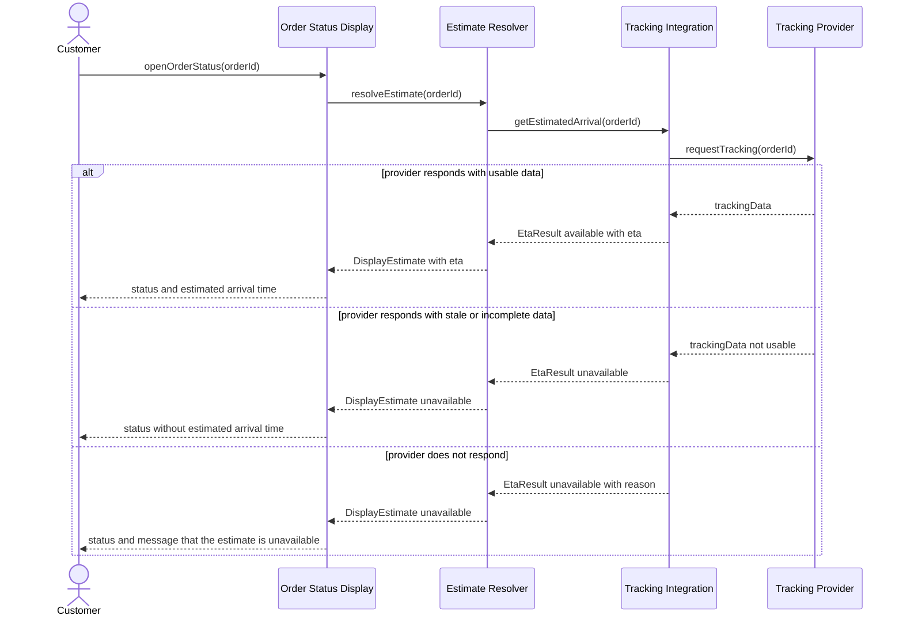
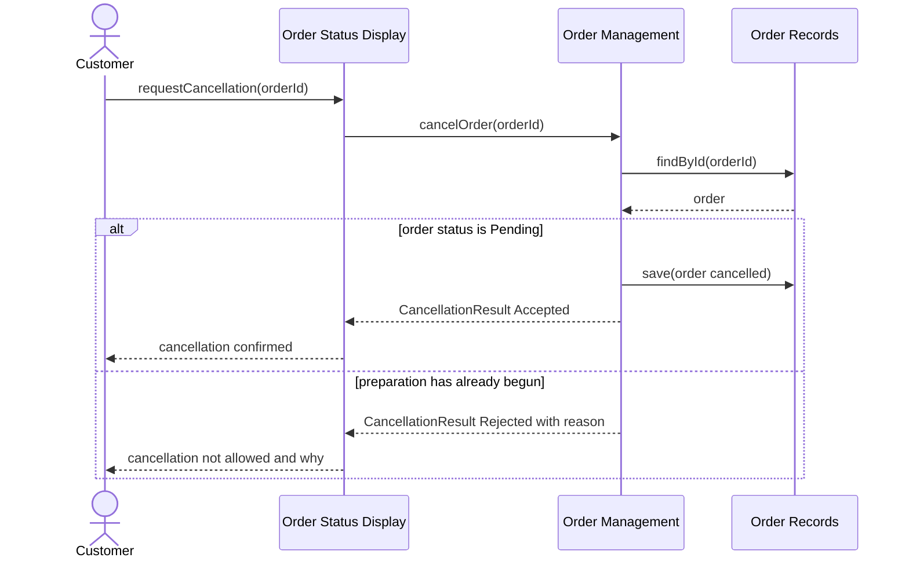
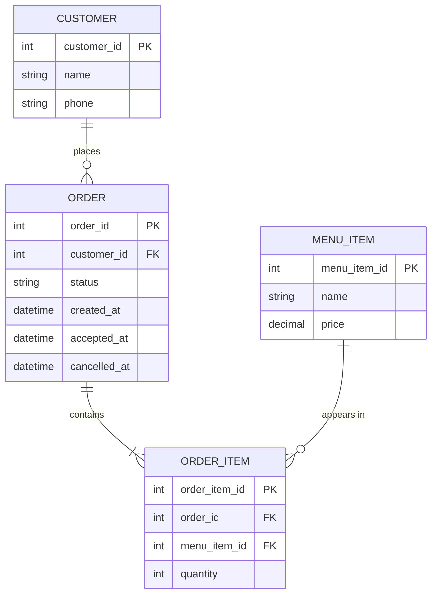

<!--
WORKED EXAMPLE — not a blank to fill in and not a project to reuse.
Food Delivery System. It continues Design_Deliverable_1_Example.md and covers the same three
requirements only (REQ-07, REQ-12, REQ-13). Your deliverable must cover YOUR own system.
Use this for level of detail and for how the consistency checks work.
-->

# Food Delivery System — Interaction & Data Design v1.0

| | |
|---|---|
| **Team** | Example Team |
| **Members** | (names) |
| **Status** | Ready for review |
| **Date** | 2026-10-14 |
| **Inputs** | `docs/design/01_Architectural_and_Detailed_Design.md`, Use Cases in `docs/requirements/`, Interaction & Contracts Design v0.1 |

---

## 1. Behavior — Selected Use Cases

### 1.1 Track Order — from requirement REQ-07

| Use Case step or flow | Message(s) in the diagram | Information exchanged | Operation defined in (Deliverable 1) |
|---|---|---|---|
| Main flow, step 1: customer requests order status | `openOrderStatus` | `orderId` | Order Status Display (customer action) |
| Main flow, step 2: system retrieves delivery information | `resolveEstimate`, `getEstimatedArrival`, `requestTracking` | `orderId`, then provider tracking data | Estimate Resolver and Tracking Integration capabilities (2.2) |
| Main flow, steps 3–4: display status and ETA | First `alt` branch, final message | `DisplayEstimate` with ETA | `EtaResult` available |
| Alternative flow: estimate unavailable, status still shown | Second `alt` branch | `EtaResult` unavailable | `FallbackHandler.unavailable` |
| Exception: provider cannot be reached | Third `alt` branch | `EtaResult` unavailable with reason | `FallbackHandler.unavailable` |

### 1.2 Cancel Order — from requirements REQ-12 and REQ-13

| Use Case step or flow | Message(s) in the diagram | Information exchanged | Operation defined in (Deliverable 1) |
|---|---|---|---|
| Main flow: cancel an eligible order (REQ-12) | First `alt` branch | `orderId`, the order, `CancellationResult` Accepted | `cancelOrder`, `OrderRepository.findById` and `save` |
| Alternative flow: reject when the rule does not permit (REQ-13) | Second `alt` branch | `CancellationResult` Rejected with reason | `cancelOrder` |

---

## 2. Data Design

### 2.1 Principal information the system needs

| Information | Needed by (use cases) | Persisted? | Why (or why not) |
|---|---|---|---|
| Customers | Cancel Order | Yes | Orders must be associated with a person over time |
| Orders and their items | Cancel Order, Track Order | Yes | Order history, and the status that BR-01 depends on |
| Menu items | Cancel Order (through order items) | Yes | Items must exist to be ordered and priced |
| Tracking data and ETA | Track Order | No | Owned by the external provider and valid only for a moment. A stored copy would be stale and would create a second source of truth. It is recomputed on every request |

### 2.2 Data model

**Justification:** relational. Orders, items and customers have clear relationships and integrity rules (an item cannot exist without its order), and the main access patterns are lookups by order and by customer.

| Entity | Meaning in the system | Identifier | Constraints |
|---|---|---|---|
| CUSTOMER | A person who places orders | `customer_id` | `phone` required |
| ORDER | One request for food and its lifecycle | `order_id` | `status` limited to Pending, Preparing, OnTheWay, Delivered, Cancelled. `cancelled_at` only when status is Cancelled |
| ORDER_ITEM | One menu item and quantity inside an order | `order_item_id` | `quantity` greater than zero |
| MENU_ITEM | An item customers can order | `menu_item_id` | `price` not negative |

### 2.3 Data Ownership

| Information | Authoritative owner | Consumed by | Access through |
|---|---|---|---|
| Orders and items | Order Management (stored by Order Records) | Order Status Display and Estimate Resolver (status only) | `cancelOrder`, `OrderRepository` |
| Customers | Order Records | Order Management | `OrderRepository` |
| Menu items | Order Records | Order Management | `OrderRepository` |
| Tracking data | Delivery Tracking Provider (external) | Tracking Integration only, transiently | `getEstimatedArrival` (nothing else sees raw tracking data) |

### 2.4 Business rules and invariants enforced in data

| Business rule or invariant | Where it is enforced | How |
|---|---|---|
| BR-01: an order can be cancelled only before preparation begins | Both | Component logic: `Order.isCancellable()` checks that status is Pending. Data: `cancelled_at` may only be set when status is Cancelled, so an invalid state cannot be stored |
| An order has at least one item, each with a positive quantity | Data | `ORDER_ITEM.quantity` greater than zero. An order is created together with its items |

---

## 3. Interface Contract

**Interaction chosen** (diagram 1.1, message `getEstimatedArrival` from Estimate Resolver to Tracking Integration):
> The point where an external, unreliable dependency meets the rest of the system.

| Element | Specification |
|---|---|
| **Operation and purpose** | `getEstimatedArrival(orderId)`: obtain a usable estimated arrival time for an active order, or an explicit statement that none is available |
| **Input** | `orderId`: non-empty order identifier |
| **Output** | `EtaResult`: either available with `eta` (a point in time), or unavailable with `reason` |
| **Preconditions** | Caller: the order is active and was accepted. Provider side: `orderId` is not empty. |
| **Postconditions** | If available: `eta` comes from tracking data that passed the freshness check, and is never a guess. If unavailable: `reason` states why. In both cases a result is always returned. |
| **Failure outcomes** | `invalidInput` (empty `orderId`). Provider does not respond: returns unavailable with reason `providerUnreachable`. Data stale or incomplete: returns unavailable with reason `dataNotUsable`. In every case no order state changes. |
| **Invariants and side effects** | Read-only: no order state changes and no tracking data is stored. Repeating the same request is safe. |

**Testable examples**

| Case | Provider response | Request | Expected |
|---|---|---|---|
| Usable data | Coordinates and a recent timestamp | `getEstimatedArrival("O-1")` | Available with an `eta` |
| Stale data | Timestamp older than the freshness limit | `getEstimatedArrival("O-1")` | Unavailable, `dataNotUsable` |
| Incomplete data | Coordinates missing | `getEstimatedArrival("O-1")` | Unavailable, `dataNotUsable` |
| No response | Timeout | `getEstimatedArrival("O-1")` | Unavailable, `providerUnreachable` |
| Empty identifier | (not called) | `getEstimatedArrival("")` | `invalidInput` |

---

## 4. Cross-Consistency & Changes to Deliverable 1

| Check | Result |
|---|---|
| Every participant in a sequence diagram is an actor, component, class or external system from Deliverable 1 | Yes. Customer is the actor. The five components are from 2.2. Tracking Provider is the external system from 2.1 |
| Every message corresponds to a capability, operation or contract | Yes. `requestTracking` and `findById` are internal operations (`RequestHandler`, `OrderRepository`). `openOrderStatus` and `requestCancellation` are customer actions handled by Order Status Display |
| Every entity is reflected in the class diagrams, or the reason it is not is stated | ORDER and ORDER_ITEM map to `Order` and `OrderItem`. CUSTOMER and MENU_ITEM have no class in this example because it covers only the cancellation and tracking flows |
| Every persisted information element has exactly one authoritative owner | Yes (table 2.3) |
| Contract, sequence and data model describe the same behavior | Yes. The contract's three outcomes match the three `alt` branches of diagram 1.1, and the contract states that nothing is stored, matching 2.1 |

**Changes made to Deliverable 1**
> Added `OrderRepository.findById` to the capabilities of Order Records. Making the cancellation sequence concrete showed that Order Management must load the order before checking its status, and the first version of Deliverable 1 did not list that capability.

---

## 5. Open Questions

> What should the customer see when the provider reports a status but no coordinates yet? Not resolved with the stakeholder. For now it is treated as "not usable" (second `alt` branch).
>
> What is the freshness limit for tracking data? No value was specified by the stakeholder, so none is invented here. It must be defined before implementation.

---

## 6. Optional — AI-Assisted Design Reflection

> An AI assistant proposed storing the last tracking response in the database "for performance". We rejected it: the provider owns that data, and a stored copy would become a second, possibly stale source of truth.

---

## 7. Consistency Checklist

- [x] Two use cases from the project, each traceable to a Use Case written in the requirements.
- [x] Each sequence diagram shows the main flow and at least one alternative or exception flow.
- [x] No business behavior is invented: anything unspecified is marked as an assumption or Open Question.
- [x] Section 2.1 explains what is NOT persisted as well as what is.
- [x] The data model has identifiers, relationships and constraints, not only boxes.
- [x] Every piece of principal information has one authoritative owner, and consumers are listed.
- [x] The contract defines input, output, preconditions, postconditions and failure outcomes.
- [x] Sequence, data model and contract describe the same behavior.
- [x] Diagrams render correctly on GitHub.
